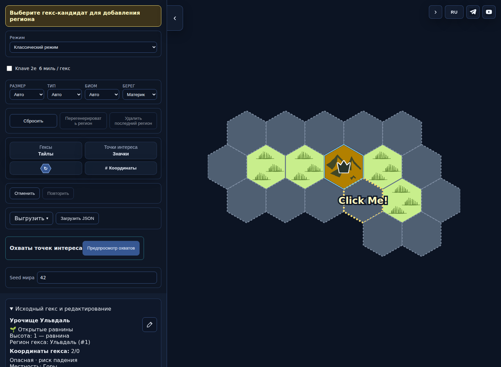
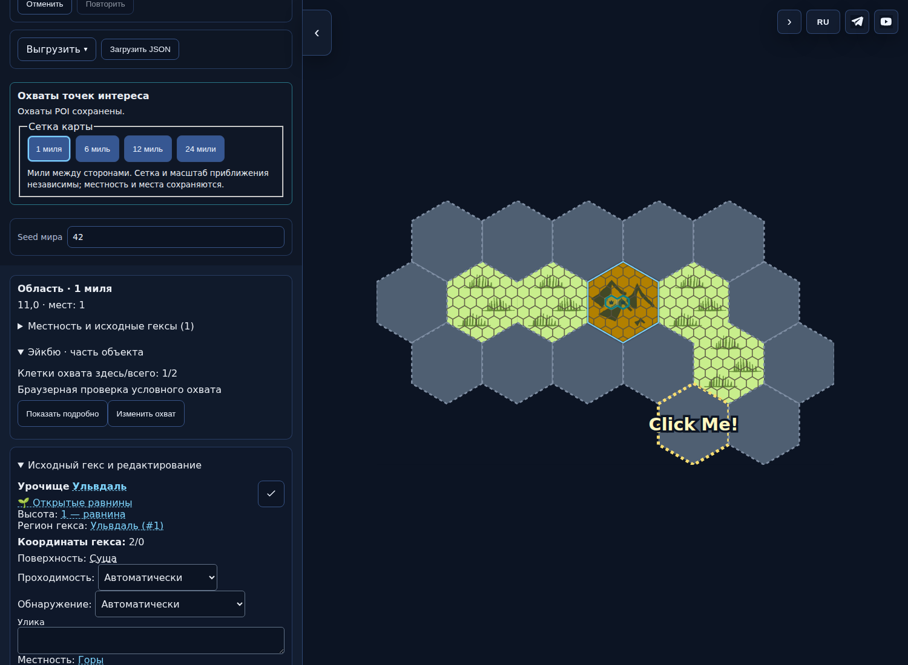
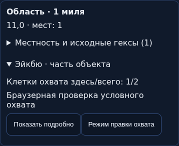
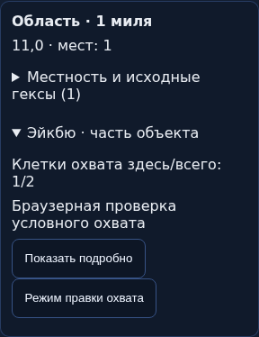

# HX-BL-051 / DETAIL1 — programmer evidence

Exact candidate `a4e8a484efcdf1bd8c38efb9e37a22c4e39a9dd9`, tree`a37e5de40297b42c72b402785241986cc1cc32ff`; PR496. Full local check and all three CI jobs passed ([run42782321639](https://github.com/YuriyEmelyanov/Hexcrawl/actions/runs/42782321639)).386 Node cases are the same suite in local/CI, not772. Browser9 top-level scripts and separate1 RNG script are separate counts. Test changes this run relativee1217b: +0/−0/modified4 (3Node,1browser), not the entire PR delta.

- [Checks](checks.json), [run test delta](test-change-summary.json), [28-AC submission, no verdict](acceptance-handoff.json), [score evidence, no awarded transition](programmer-score-evidence.json).
- [Actual UI walkthrough](ui/walkthrough.json). Before means legacy state before adaptation in this same build, not previous production. Images shown in current task chat; no design gate or release permission inferred.

| Before adaptation | After adaptation |
|---|---|
|  |  |

|390px|320px|
|---|---|
|||

[Rotation](ui/detail1-rotated.png) · [Actual selected-view PNG](ui/detail1-selected.png).

Independent reviewer must verify full DETAIL1+integrated CLASSIFY1 on this SHA, reproduce needed negative cases and resolve listed evidence gaps. Touch/long names/overlapping-POI actual flow, visible errors/focus, SVG and12/24 screenshots/response timing are not established by this single-capital workflow. Historical RIV011 remains unknown; no heavy new series is authorized. No merge/publication authorized.
