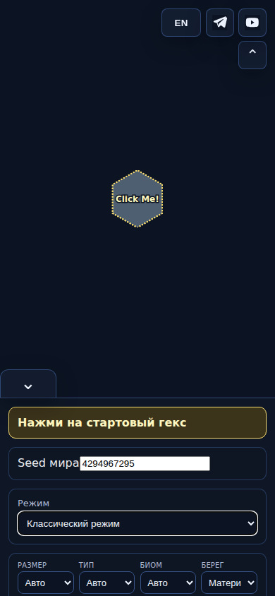
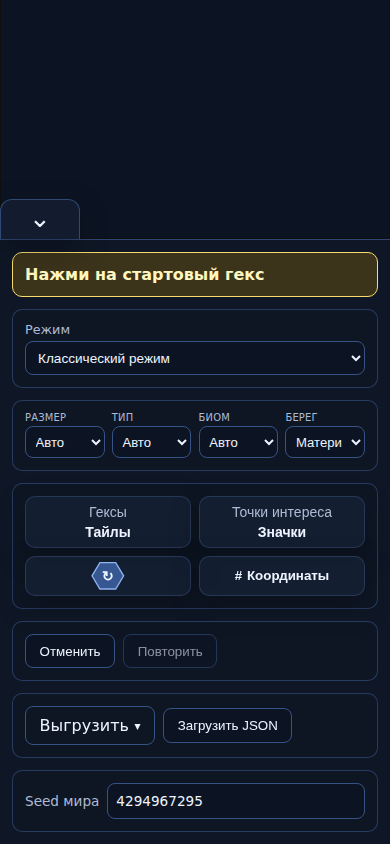

# HX-FB-001 — результат разработчика

PR [№475](https://github.com/YuriyEmelyanov/Hexcrawl/pull/475), spec1.1.
Проверяемый head: 415349bc9fb9ce72fb2a8bc5e777cc98ea515bd0.
Baseline main: 103d31b9f6f5c76b1f6b45d9d6664fe3f75dd63b.

## Что изменилось

«Seed мира» / «World seed» и поле стоят в одну строку под выгрузкой/загрузкой. Тёмные стили ограничены этим блоком. Focus, ошибка и режим только чтения различимы; ошибки и legacy notice расположены ниже пары. При открытом меню выгрузки резервируется место под popup, при закрытом меню дополнительного промежутка нет. Это исправляет перекрытие, найденное при ручном просмотре первых снимков.

Обработчики seed, readOnly/disabled, RNG, генерация, JSON и undo не изменены. Отдельный пакет от main; performance-кандидат PR474 не включён. Main и опубликованный сайт не изменялись.

## Фактические снимки

Это снимки production-сборок baseline и candidate из Chromium, не макет. Пустая карта и одинаковый seed4294967295;1500×1000 и390×844, RU/EN.

| До,390px RU | После,390px RU |
|---|---|
|  |  |

[Desktop до](screenshots/baseline-1500-ru.png) · [Desktop после](screenshots/candidate-1500-ru.png) · [Телефон EN](screenshots/candidate-390-en.png) · [Открытое меню](screenshots/candidate-390-ru-menu.png) · [Фокус](screenshots/candidate-390-ru-focus.png) · [Ошибка](screenshots/candidate-390-ru-error.png) · [Read-only classic](screenshots/classic-readonly.png) · [Read-only Mythic](screenshots/mythic-readonly.png).
Полный набор22PNG имеет SHA256 и git-blob идентификаторы в screenshots-manifest.json; бинарные blobs проверены до включения в дерево.

## UI-приёмка

[UI run40284793677](https://github.com/YuriyEmelyanov/Hexcrawl/actions/runs/40284793677) прошёл на415349b:
- Все4сочетания desktop/390px и RU/EN: пара в одной строке, input справа, блок после transfer и вне details,10цифр помещаются, горизонтального переполнения блока нет.
- В каждом сочетании проверены0/MAX и6невалидных строк. Ошибка не меняет полный сохранённый документ. Фокус доступен клавиатурой.
- Popup не накрывает seed: явная проверка границ popup/seed-block и ручной просмотр desktop/mobile снимков.
- В classic иMythic полные документы после первого и следующего действий совпали с baseline; undo/redo, загрузка checkpoint, продолжение и отображаемый seed после reset прошли.
- JavaScript errors:0. Успех конечного набора не является доказательством всех возможных устройств/seed.

Артефакт12633348183,621686байт, SHA256632d3dedd1c47f30ade324d00f6700e73d98edc2fef9164ef30ad46b3298efe7 скачан и сверён. Raw ui-result.json и полный ci-ui.log сохранены.

## Обычные проверки

Финальный [Check40284793669](https://github.com/YuriyEmelyanov/Hexcrawl/actions/runs/40284793669), head415349bc9fb9ce72fb2a8bc5e777cc98ea515bd0, attempt1: все3jobs success. Check job121445805437:236/236 Node-тестов, TypeScript/build success; browser job121445804852: весь штатный smoke/history набор success; world-random job121445805231: uint32 seeds0/1/123456789/MAX, classic/Mythic, fresh/continuation/undo/invalid import, busy guards success. Полные ci-check.log, ci-browser.log и ci-rng.log приложены. Chromium installer в стандартном browser job занял около8минут, затем тесты прошли; повторов CI не было.
Локальный Node24.22.1 npm run check на исходной реализацииb2a59d4:236/236, TypeScript/build success. На415349b App.tsx не менялся; изменены scoped CSS и проверочный harness/документация. Локальная установка Chromium завершилась ошибкой повреждённого CDN ZIP; локальная browser-приёмка не заявляется. CI использует реальный Chromium.

Старые Check40283931887 иUI40283931861 наb2a59d4 прошли, но ручной просмотр выявил перекрытие меню, которое прежняя isVisible-проверка пропускала. Эти результаты не заменяют проверки415349b. Сохранены prior-ui-result.json и prior-ci-ui.log; artifact12633915272 имеет SHA2565275ff12f94983c350a6a5655ba11eb53e248831d166974b3e71de63517219d3.

## Передача score1.2 и ограничения

| Критерий | Evidence | Ограничение |
|---|---|---|
| S02-C01 | ui-result.json: seed0/MAX, ошибки; полные first/next/continuation в2режимах; штатный RNG CI | Конечные seed/сценарии; новый grade не назначается. |
| S03-C05 | Полные документы после undo/redo/reset/import вUI; штатный history/browser набор | Нет новых именованных версий или расширения undo. |
| S04-C04 | JSON round-trip/continuation и доступность меню; штатный browser набор | Новый формат/экспорт не добавлен; большие PNG из003 не проверялись. |
| S09-C04 | Ошибочный seed сохраняет документ; обработчики и busy/readOnly guards прежние; штатные проверки | В отдельном UI-harness нет нового полного fuzz/busy/legacy набора; существующее CI и source evidence различаются. |

Модель1.2 применяется; before1.2 unknown, исторические1.1 значения в spec. Прогноз score-neutral, подтверждённые баллы разработчик не начисляет. Независимый reviewer должен проверить точный SHA, все AC и записать score_assessment1.2. Отдельные legacy notice, общий collapse панели и ручное копирование readOnly не объявляются полностью проверенными только по наличию снимков: source сохранён, reviewer проверяет применимые пробелы. Автоматическая проверка readonly и клавиатурного фокуса прошла; нет утверждения об универсальной accessibility-приёмке.

Публикация требует отдельного разрешения владельца. Feedback до выпуска не закрыт. Команда остаётся включена.
