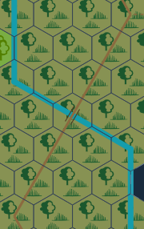
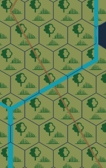
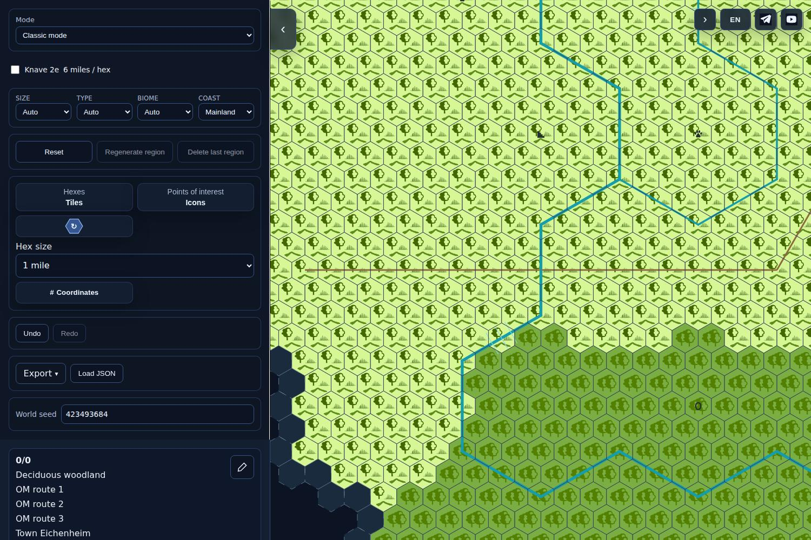
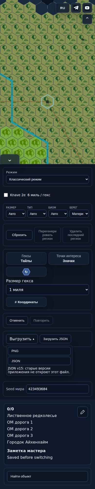

# ONE-MILE1 OM-C02/C05 — actual UI

Exact source head **60059737ec94b54db88c2f49c8d16e99da7d85a8**, tree **705c41da8d45f9c4a4afafc37426d32d402465af**. [PR503](https://github.com/YuriyEmelyanov/Hexcrawl/pull/503), [CI 43318832482](https://github.com/YuriyEmelyanov/Hexcrawl/actions/runs/43318832482). These are actual Chromium 151 production-build screenshots and PNG exports, not mockups. This is programmer evidence, not independent acceptance or release permission.

One existing road-entry-zigzags world, explicit legal river3 sector1 F2 crossing bridge→ford variant and prior explicitly conditional three-mile POI fixture. No statistical world series and no claimed real town measurement. The source package does not change geographic data, crossing identities/kind, POI dimensions, catalogue, JSON schema or RNG. Town Eichenheim still has disputed catalogue extent; this stage only prefixes its actual type.

## Actual crossing artwork

Bridge: road continues, paired rails.

Ferry: road gap across current visible water, without a full road underneath.

Ford: translucent crossing portion; the shallow road-angle example below is a genuine crop of the same renderer.

## Current interface

The desktop/narrow actuals were presented in the owner chat for this exact source SHA. Owner viewing/approval is unknown. No design-answer gate.

## Native6 before/after

Same prepared world and 6-mile native view, baseline d41911b8d7c2248f115b182923350dc8d08c0a48 versus current source. Pixel-identical at both1500/390, stabilized CSS transitions for comparison. This demonstrates correction regression only on this fixed world/profiles, not universal validation of the remaining geography requirements.

| Width | Before | After | Result |
|---|---|---|---|
|1500|[before](native6-before-1500.png)|[after](native6-after-1500.png)|pixel-identical|
|390|[before](native6-before-390.png)|[after](native6-after-390.png)|pixel-identical|

## Exports and limitations

[Actual tiles PNG](fine-tiles.png), [emoji PNG](fine-emoji.png), [rotated color PNG](fine-color-rotated.png); hover PNG is byte-identical to the first export. [Manifest](manifest.json) records5 fine UI cases, full local read evidence, camera, PNG and busy profiles. Inventory is ../original-inventory.json. All38 artifact originals retained:33 screenshots,4 exported PNGs,1 manifest.

Still open: OM-C01/03/04/06/07/08 and geographical OM-C02 (fine edge correspondence, river-adjacent POI, extent correctness, river mouths, physical width and town-size basis). Current river width/anchor images are not presented as fixes for these clauses. No real mobile-device test claimed. Exact newSHA independent review and all remaining work precede any whole-package publication decision.
