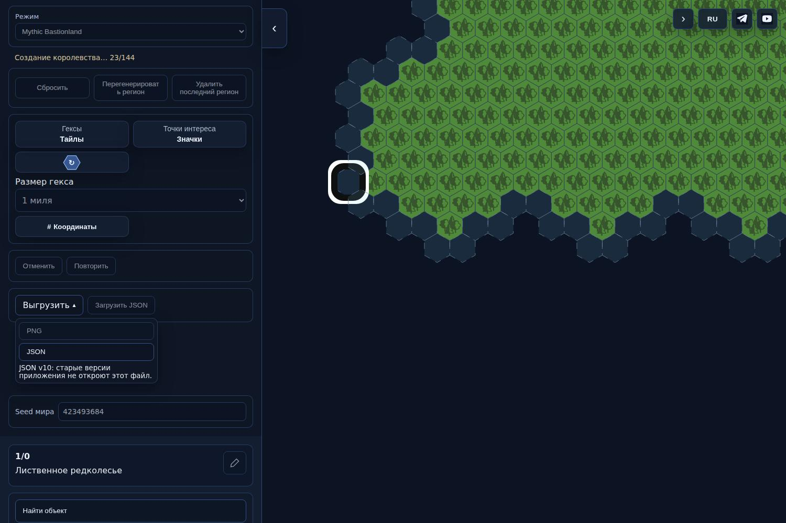
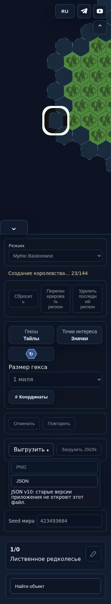
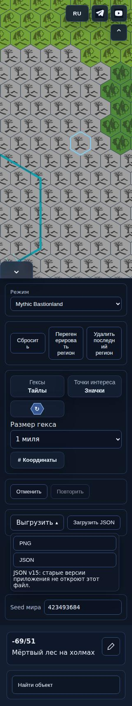

# OM-REV-001 — actual UI, d41911b

Exact source `d41911b8d7c2248f115b182923350dc8d08c0a48`, tree `ec3fbcab8bb976cdd189f82f1b21bf264f23e7db`. [CI326](https://github.com/YuriyEmelyanov/Hexcrawl/actions/runs/43215219149), artifact13943632193. Original ZIP SHA2567bb0be1024d8dd42d9cfe8a1a7c26056a0399c19bf11554eb7bc2c274c313ccc verified. These are actual production build screenshots/PNG, not a proposal.

Before: [2ad320busy — blank map](https://github.com/YuriyEmelyanov/Hexcrawl/blob/d106088c10dc979afbb0b8ea94d9e5085245cd61/agent-work/evidence/ONE-MILE1-completion-0800/actual/narrow-320-busy-kingdom.jpg).

| State | Desktop1500 |390|320|
|---|---|---|---|
|Before candidate|[view](desktop-before-kingdom.jpg)|—|—|
|Real generation in progress|[view](desktop-busy-kingdom.jpg)|[view](narrow-390-busy-kingdom.jpg)|[view](narrow-320-busy-kingdom.jpg)|
|Accepted whole kingdom|[view](desktop-after-kingdom.jpg)|[view](narrow-390-after-kingdom.jpg)|[view](narrow-320-after-kingdom.jpg)|

The accepted1-mile artwork/card and SVG dimensions remain visible while edits are disabled. New provisional POIs are not bound to paths until complete acceptance. Final Mythic4→29regions,0→1kingdom, exact UndoRedo; Knave4→5 and exact UndoRedo also pass. The ordinary unit can extend beyond one displayed fine cell.

For responsive capture only, the real intermediate native timer is held after3ticks and then released. This is not a wall-clock performance/smoothness measurement. Same accepted scene/frame before/during is asserted at1500, artwork/visibility at390/320; finish/refusal checks use real continuation. The first run raced native completion before320capture; negative log and classification are retained in../triage.json.

[Full actual manifest](manifest.json), [original blob hashes](binary-hashes.json). 26JPEG and4PNG, RU/EN read/edit/empty/error/importbusy plus generation. The fixed scene has an explicitly conditional3mi POI extent; not a measured place or changed catalogue. [Tiles PNG](fine-tiles.png), [hover-identical PNG](fine-hover.png), [emoji](fine-emoji.png), [color rotated](fine-color-rotated.png): genuine production exports, stable native paths/water and no editor masks. Original artwork focus outline is retained during busy; no palette redesign in this fix.

Representative final actual images shown in task chat on2026-11-12. Owner viewing/approval unknown. Programmer evidence only; OM-REV-001 remains addressed_pending_independent_review and full new-SHA review/score_assessment1.2 required. No publication authorization.
