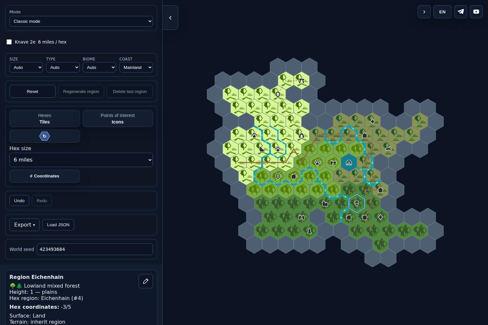
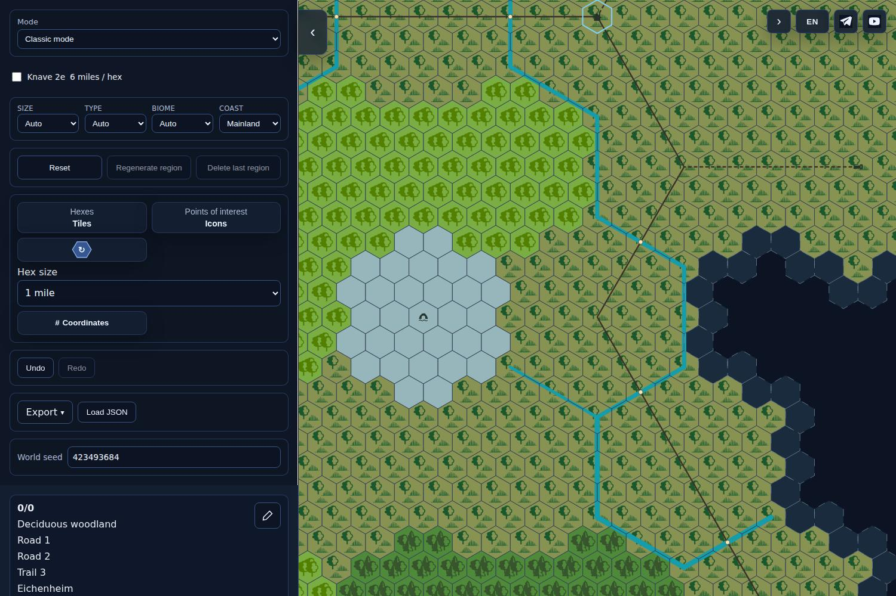
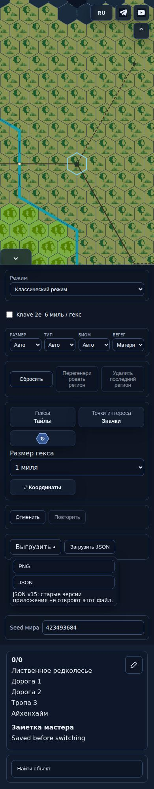
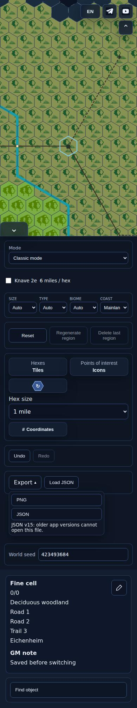
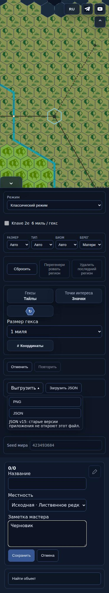
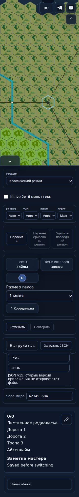
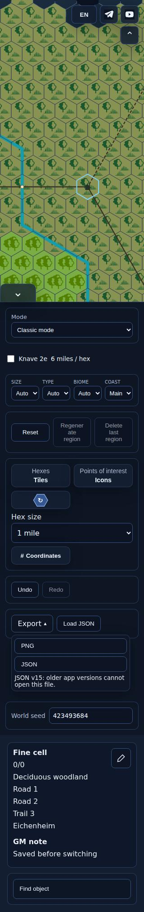
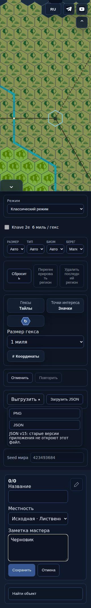

# ONE-MILE1 — фактический интерфейс

Рабочая сборка [PR503](https://github.com/YuriyEmelyanov/Hexcrawl/pull/503), точный SHA [e75383dbaa1832c75e3b1686ee4edd55080ff3b6](https://github.com/YuriyEmelyanov/Hexcrawl/commit/e75383dbaa1832c75e3b1686ee4edd55080ff3b6). Это снимки настоящего браузера CI, не макет и не опубликованная версия. В обоих режимах одна карта `road-entry-zigzags.json`.

| 6 миль | 1 миля |
| --- | --- |
|  |  |

В одномильном режиме показаны собственные изображения биомов, исходные дороги/тропы/реки, один ряд кандидатов и локальная карточка. Карандаш редактирует имя, биом и заметку именно выбранного одномильного гекса.

| Экран | Чтение RU | Чтение EN | Редактор RU |
| --- | --- | --- | --- |
| 390 px |  |  |  |
| 320 px |  |  |  |

[Manifest и четыре проверенных сценария](manifest.json). Проверены H/S, локальные Save/Cancel/IME/исключение подготовки/UndoRedo, узкие экраны и одна обычная генерация с точным Undo. Это ограниченная проверка одной карты.

Пакет ещё не готов к полной приёмке: остаются сценарий старого generation checkpoint/регенерации с локальными правками и полная матрица камеры/PNG/состояний. Показ не требует промежуточного согласования и не разрешает публикацию.
