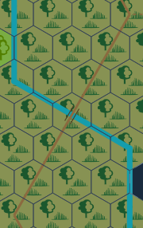
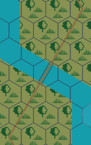
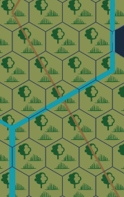
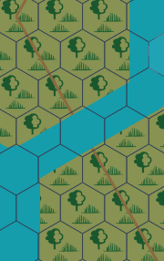
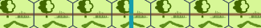
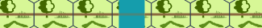
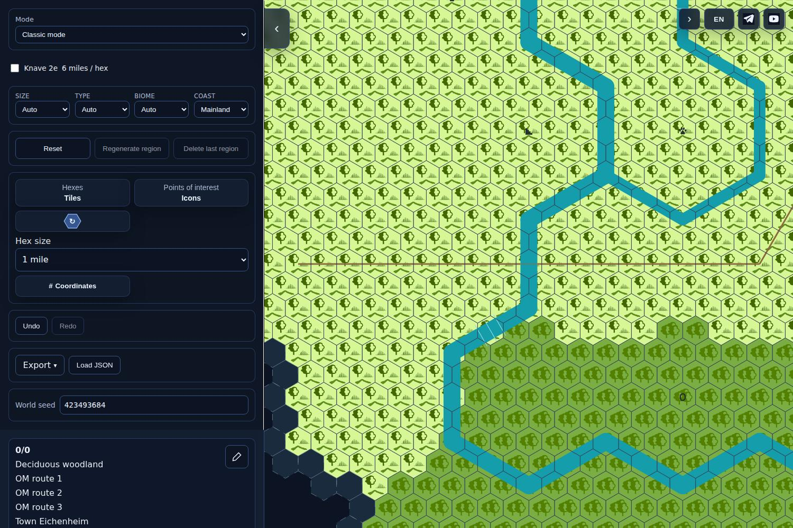
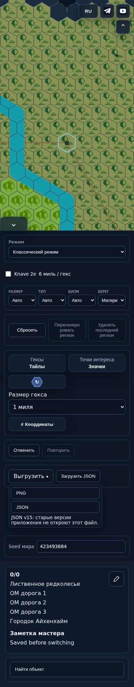

# WR1 actual exact-SHA evidence

Source **3344159406c3619bc3903e7185f7b0a5c4d13de5**, tree **1b782342aad359487fe35c9050cff7a78c4fb7b5**. [PR503](https://github.com/YuriyEmelyanov/Hexcrawl/pull/503), [CI](https://github.com/YuriyEmelyanov/Hexcrawl/actions/runs/43363246575). Actual Chromium production screenshots/PNG, not mockups. Programmer evidence, independent review pending; no release permission.

## Before/after correction
Before is source60059737ec94b54db88c2f49c8d16e99da7d85a8, not published main. Same existing road-entry-zigzags fixture/preparation code, explicit legal river3 sector1 F2ford variant and prior explicitly conditional3mile POI. No statistical series. Historical input payload byte-hash not claimed; stable source/fixture preparation establishes comparison scope.

|Kind|Before6005973|After3344159|
|---|---|---|
|Bridge|||
|Ferry|||
|Ford, explicit legal F2|||

Same visible water width in6/1; ferry gap/ford span/bridge rails follow actual water envelope. IDs/kinds/locations unchanged.

## Actual interface
[Before desktop](../before-6005973/desktop-1.jpg) / [before390RU](../before-6005973/narrow-390-read.jpg).

ExactSHA desktop/narrow/crossing actuals were shown in owner chat. Owner viewing/approval unknown; no third design gate.

## Native6 and real exports
Native6 same-world befored41911b8d7c2248f115b182923350dc8d08c0a48 / aftercurrent are pixel-identical1500/390; decoded pixels rechecked. [Before1500](native6-before-1500.png) / [after1500](native6-after-1500.png); [before390](native6-before-390.png) / [after390](native6-after-390.png). This is bounded correction regression evidence.

[Tiles PNG](fine-tiles.png), [emoji PNG](fine-emoji.png), [rotated color PNG](fine-color-rotated.png). Hover PNG byte-identical to tiles. [Manifest](manifest.json):5 fine UI cases; source/fine widths48.497406/8.082901; same water widths/coordinates for53 river segments, water/hex fraction ratio6. PNG comparison includes widths/road opacity/dashes/rails/POI labels as well as coordinates/shores. [Inventory](../original-inventory.json) retains38 actual originals (33screenshots/4exports/1manifest) plus5 selected before originals by original GitblobSHA.

## Limits remain open
Legacy F1 becomes45% of fine hex width, not a new physical calibration or full 'большая часть' acceptance. River paths/grid/POI anchors/extents/schema/RNG/native6 are unchanged; no new hydrology/cell-classification migration. Existing lake/shore/local-water and rotated PNG actuals inspected: old mouth/source connector geometry C06 is not certified. Fine edge routing, required shoreline POI, disputed town0.8mi, general finite/endcap envelopes and GEO-D01 remain open. No new real mobile-device check; responsive1500/390/320 only. Full HX-FB-023 is not resolved; exact newSHA independent review still required.
