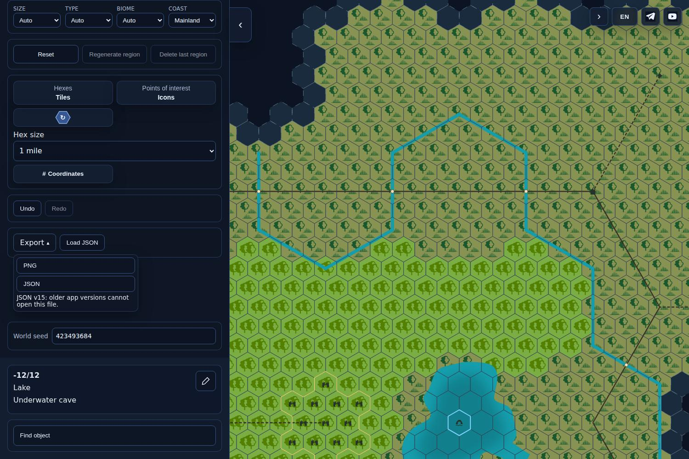
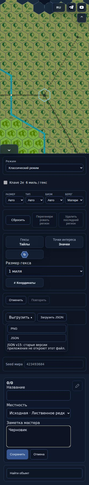
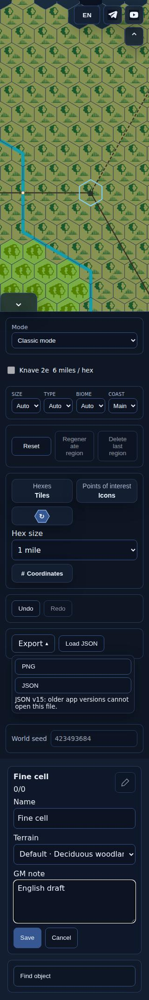

# ONE-MILE1 — actual UI / PNG, PR503

Source: `2ad03ad256e824a1ee07cef8e0d90a75077ef75e`; tree `e126282258e805cee851a8274fd645810a2e2f2d`.
[Check CI324](https://github.com/YuriyEmelyanov/Hexcrawl/actions/runs/43185043580), ONE-MILE1-UI artifact13929295035. The merge checkout has exactly the source tree; manifest preserves provenance. Actual production browser screenshots and PNG exports, not a proposal.

## Same map, local reading and water correction

| State | Actual image |
|---|---|
| Native6 | [desktop-6.jpg](desktop-6.jpg) |
| Fine1 | [desktop-1.jpg](desktop-1.jpg) |
| River/crossing local card | [desktop-local-river.jpg](desktop-local-river.jpg) |
| Lake + underwater POI | [desktop-local-water-poi.jpg](desktop-local-water-poi.jpg) |
| Empty local neighbour in the same source6 | [desktop-local-empty-local.jpg](desktop-local-empty-local.jpg) |
| No selection | [desktop-fine-empty.jpg](desktop-fine-empty.jpg) |
| Injected preparation error | [desktop-fine-error.jpg](desktop-fine-error.jpg) |

Before lake correction at9ef: [card](../before/water-card-9ef.jpg), [PNG](../before/fine-tiles-9ef.png). The old fine render lacked the native lake shoreline in tiles/emoji and called this lake Sea. Current images show the shoreline and Lake.

## Narrow panel

| Width | RU read / edit / error / import busy | EN read / edit |
|---|---|---|
|390|[read](narrow-390-read.jpg), [edit](narrow-390-edit.jpg), [error](narrow-390-error.jpg), [busy](narrow-390-busy-import.jpg)|[read](narrow-390-en-read.jpg), [edit](narrow-390-en-edit.jpg)|
|320|[read](narrow-320-read.jpg), [edit](narrow-320-edit.jpg), [error](narrow-320-error.jpg), [busy](narrow-320-busy-import.jpg)|[read](narrow-320-en-read.jpg), [edit](narrow-320-en-edit.jpg)|

[Actual320 Mythic progress](narrow-320-busy-kingdom.jpg): observed temporary native6-mile busy state, controls disabled; this capture has a blank map viewport while the kingdom is building. Fine1 returns after whole-unit acceptance. Explicit OM06/14 review focus; no claim that the map stays visible throughout this busy interval.

## Genuine clean PNGs

[Tiles](fine-tiles.png), [same tiles with hover](fine-hover.png), [emoji](fine-emoji.png), [color rotated](fine-color-rotated.png). Production export; live/PNG geometry equality, native lake count1 in each, no editor masks, scale2. Tiles/hover bytes identical. See [manifest.json](manifest.json) for exact results.

## Scope and provenance limits

Fixed accepted world master seed423493684, named local routes/rivers. Multi-part POI uses an explicitly conditional manual3-mile extent prepared with the production edit function; not a measured place or changed catalogue. Error screenshots deliberately inject a preparation fault. Import busy holds the real FileReader. Touch uses actual emulated native events at390/320. Six camera profiles / three ordinary modes / four PNGs remain profiles, not extra Node cases or broad geographic certification.

Representative final actual images were presented in the current task chat on2026-11-12; owner viewed/approved is unknown. No independent acceptance or publication approval is implied. [Binary hash inventory](binary-hashes.json) verifies exact downloaded originals.
