# ONE-MILE1 — фактический проход перед публикацией

Пакет PR503 `d41911b8d7c2248f115b182923350dc8d08c0a48`, tree `ec3fbcab8bb976cdd189f82f1b21bf264f23e7db`. До — чистая сборка опубликованного main `1962fb9a835a9c310e55c1a09415fe180f22cca9`; после — чистая сборка принятого пакета, **не опубликована**. Это оригинальные снимки работающих сборок, не макет. Проверка live-сервера этим capture не выполнялась.

Один неизменённый публичный fixture `road-entry-zigzags.json`, версия2, SHA256 `cb2333bc60a64dcdffe44f49bbba680b6f496afc6f7a0d46cb38d56a26f52d01`. Seed продолжения423493684;4региона/7дорог/6рек/7переходов. Legacy-import в обеих сборках даёт одинаковую географию. Локальные правки сделаны только на0/0. Имена путей/рек не подменены для съёмки. Исходники обеих сборок не изменялись.

[Успешный capture](https://github.com/YuriyEmelyanov/Hexcrawl/actions/runs/43255616014), artifact13959979468, ZIP SHA25655f67e617c4beb04e111690657e5ce77916cd13b4ea3546074d7b371b76282e4. Все45 оригиналов сохранены рядом:30PNG,14JSON и manifest. `original-inventory.json` задаёт blobSHA/size/hash. Временный script в родительском каталоге — материал съёмки, не постоянный продуктовый набор.

## До и после: настольный экран

|Опубликованная версия,6миль|Принятый PR503,6миль|
|---|---|
|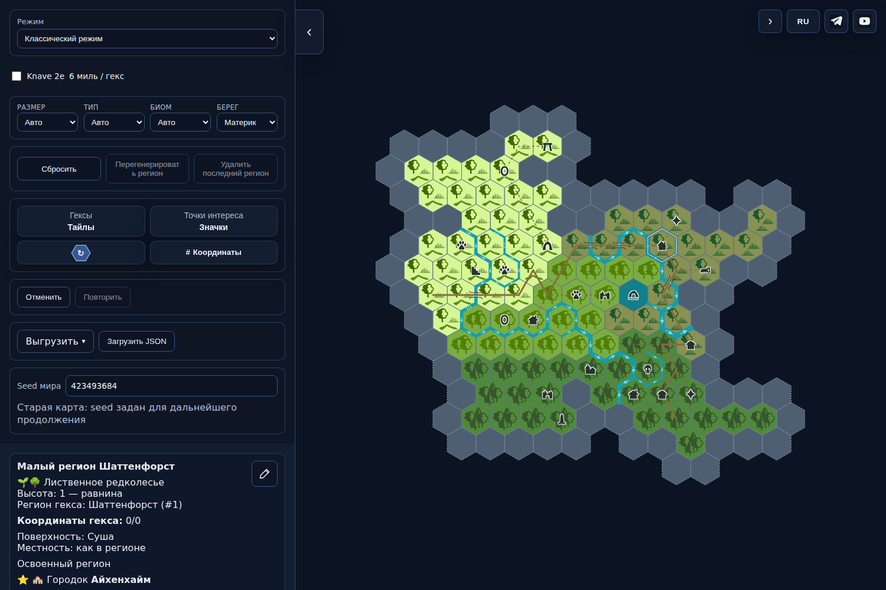|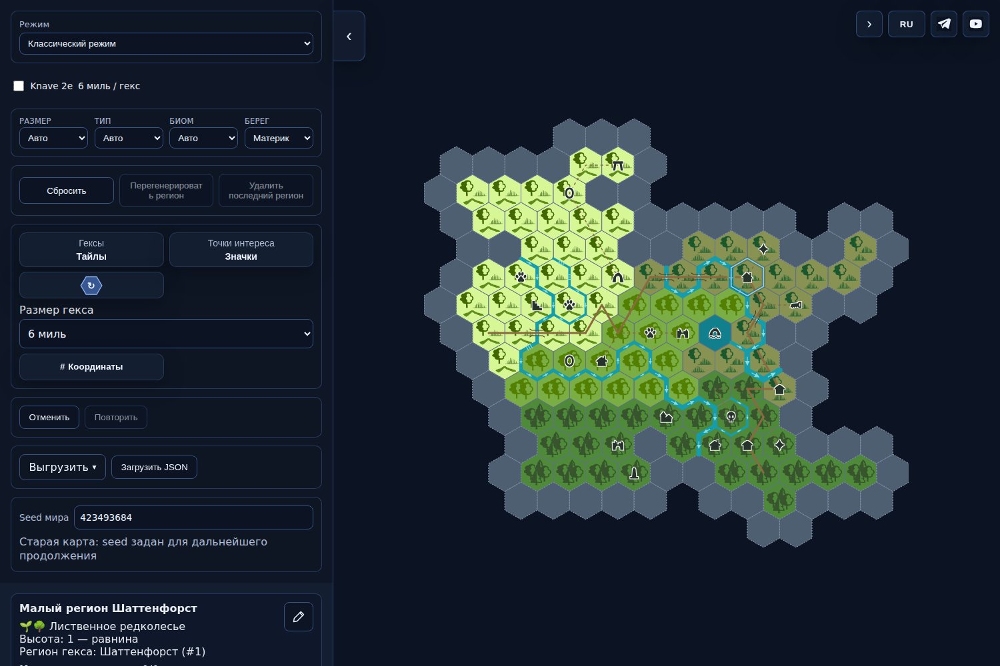|

1. В «Размер гекса» выбрать «1миля». Для старой карты появляется явный предпросмотр — «Применить» либо «Отмена».

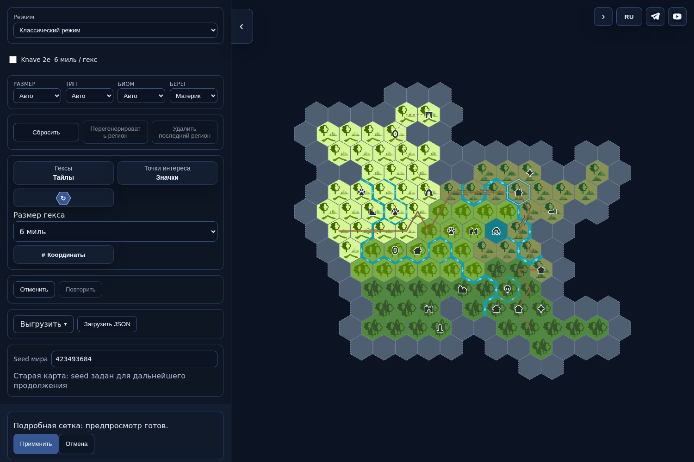

2. Применить, выбрать0/0. Показана отдельная одномильная клетка; дороги/тропа/Айхенхайм относятся к ней. Смена сетки увеличивает масштаб, карта прокручивается/масштабируется обычными действиями.

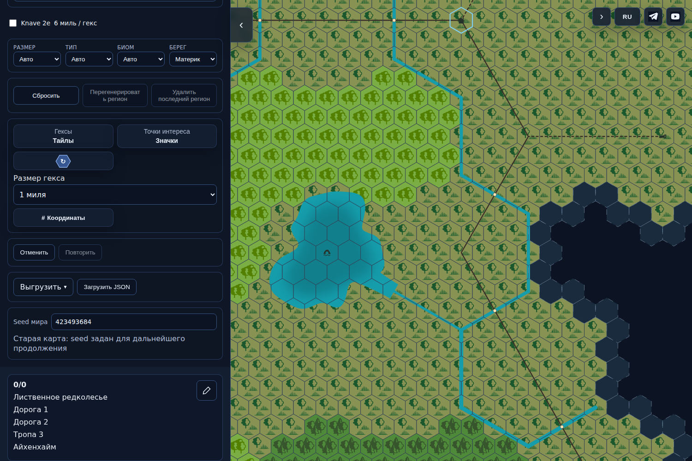

3. Карандаш → название «Лагерь у переправы», заметка «Осмотреть берег перед переходом.» → «Сохранить». Эти записи относятся к0/0; исходные6-мильные данные, соседи и RNG сохранены.

|Черновик|Сохранено; повторено; вновь открыто изJSON|
|---|---|
|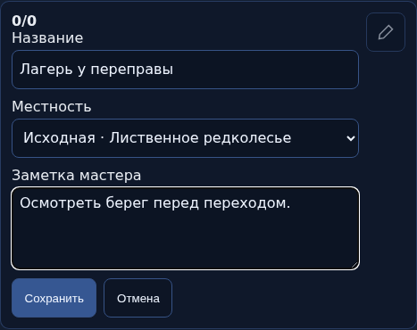|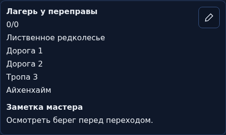|

4. «Отменить» точно возвращает прежнюю карту/RNG; «Повторить» возвращает правку. Экспорт/повторная загрузкаv15 сохраняют её. Отдельный черновик отменяется кнопкой«Отмена», не изменяя принятое.

|После Undo|После Cancel|
|---|---|
|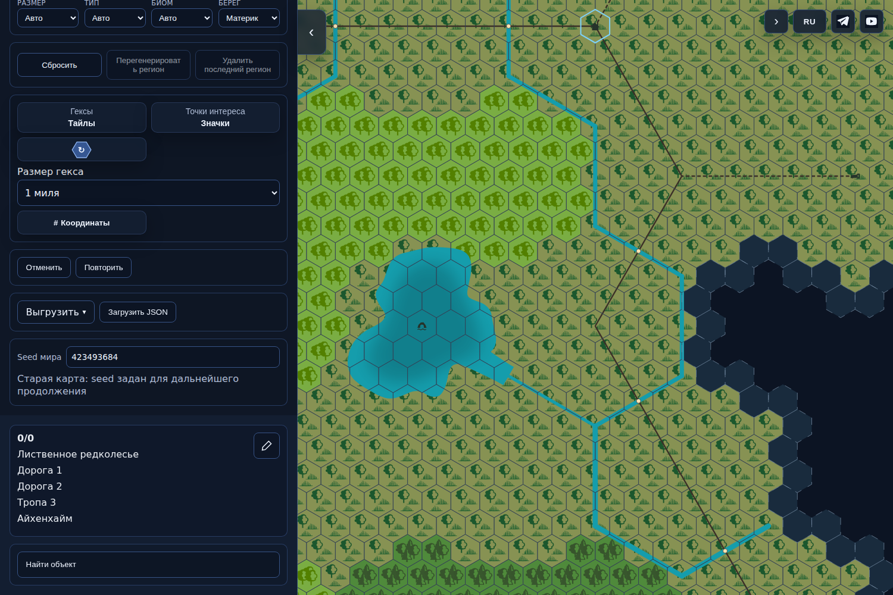|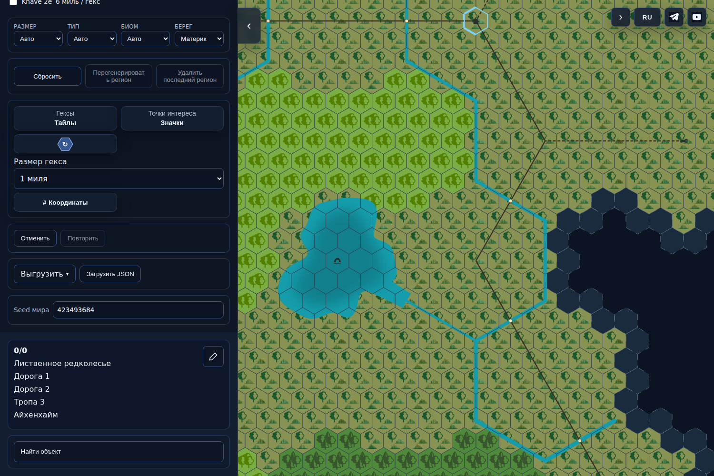|

## Локальное чтение

|0/0:дороги и тропа|−3/9:река и мост|1/0:сосед без этих объектов|
|---|---|---|
|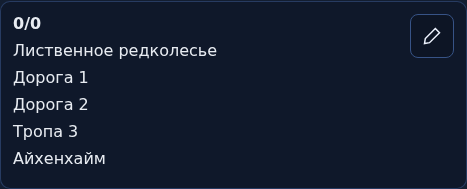|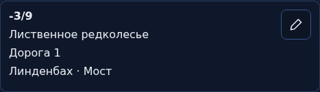|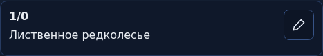|

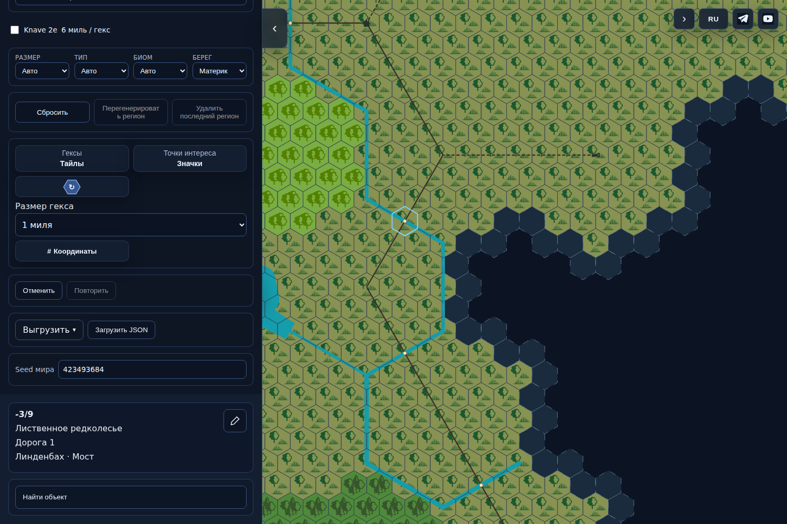

## Узкий экран390

Карта расположена сверху, настройки и карточка ниже. Прокрутить страницу к«Размер гекса» и карточке; прокрутка карты отдельная. Save/Cancel расположены под заметкой, доступны без горизонтальной прокрутки страницы. Проверкаdesktop/390 — browser viewport, не физический телефон.

|До,main6|После,d4191|
|---|---|
|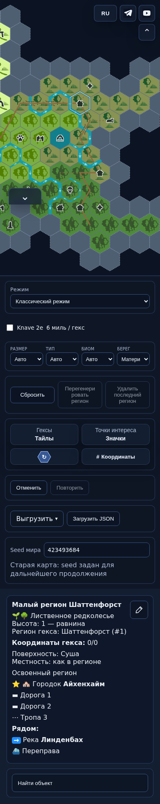|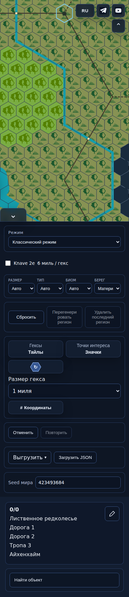|

|Редактор|После Save/Redo/повторного открытия|
|---|---|
|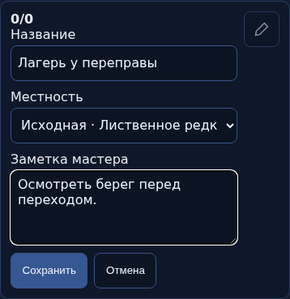|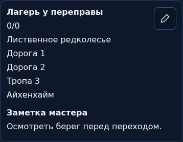|

[Save](after-390-3-saved.png), [Undo](after-390-4-undo.png), [отмена черновика](after-390-5-cancelled.png). Оба профиля1500/390 прошли точные map/RNG сравнения, overflow=false, pageerror/dialog=[]; см.manifest.

## Границы и известные ограничения

- Поддерживаются виды1/6;12/24 и C-FILL не входят в пакет.
- Водная и смешанная клетка: биом не редактируется, имя/заметка доступны.
- Fine JSON v15 не читается прежним опубликованным main; сохранение исходной карты отдельно до перехода.
- Во время построения Mythic карта readonly, экспорт/импорт блокируются; промежуточная подсказка v10 известна проверяющему.
- Толстая белая рамка клавиатурного фокуса кандидата остаётся; реальное мобильное устройство не проверено этим прогоном.

Предыдущие read/edit/empty/busy/error320/390/RU/EN иPNG относятся к тому жеd419, но отдельной подготовленной версии этого мира с условным3miPOI: [прежние принятые evidence](../../ONE-MILE1-OM-REV-001-1200/actual/README.md). Не выдаются за новый main-before. Busy Mythic снимался с удержанием реального промежуточного tick только на время съёмки; не performance benchmark.

Независимая приёмка кода: [reviewd419](../../review-ONE-MILE1-d419-1400/independent-review.json). Следующий этап — независимая сверка применимости этого walkthrough к точному пакету; затем отдельное разрешение владельца на публикацию. Score не повышен. PR496 остаётся на hold. Отсутствие ответа на показ не означает разрешения публикации.
