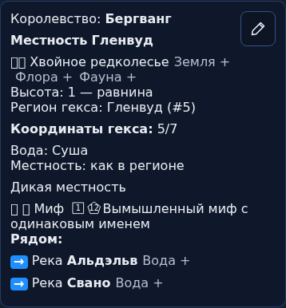
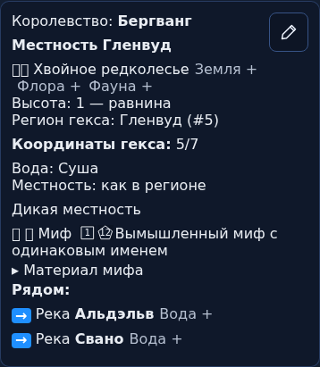
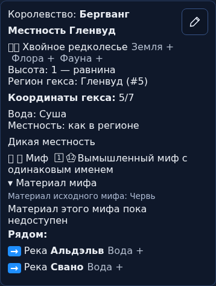

# PR493 — фактическое сравнение интерфейса

База00190bb и кандидат2f11a4b; точные tree и хешы одинакового входного/принятого документа — в manifest.json. Имена явно вымышлены, snapshot тегов допустим для обеих версий. Реестр материала production пуст, подстановки материала здесь нет.

На1500/390px: импорт той же карты → выбор мифа5/7 → новый элемент «Материал мифа» → раскрытие честного состояния недоступности. Карта при чтении не меняется; размеры панели равны её scrollWidth. Узкая пара независимо проверена свежим reviewer.

До:

После, закрыто:

После раскрытия:

Desktop: соответствующие файлы1500-panel.png. Непроверенное: физический touch, AT, полное WCAG. Системные emoji boxes видны и на базе. Эти кадры показывают техническое ядро, а не готовые72материала или разрешённый выпуск.
