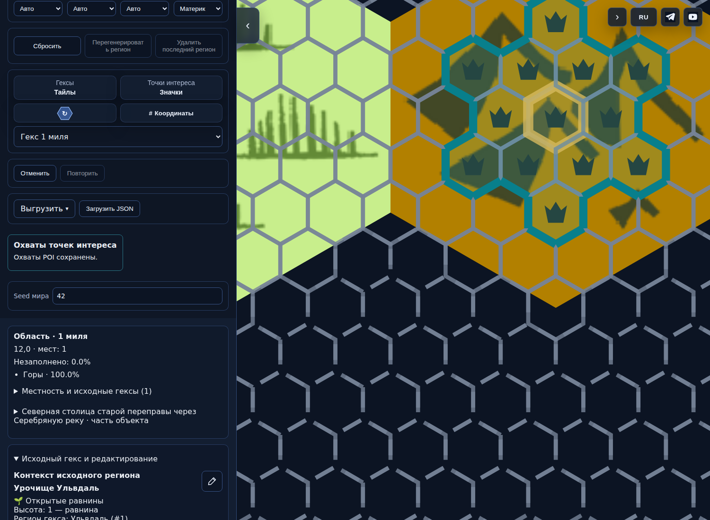
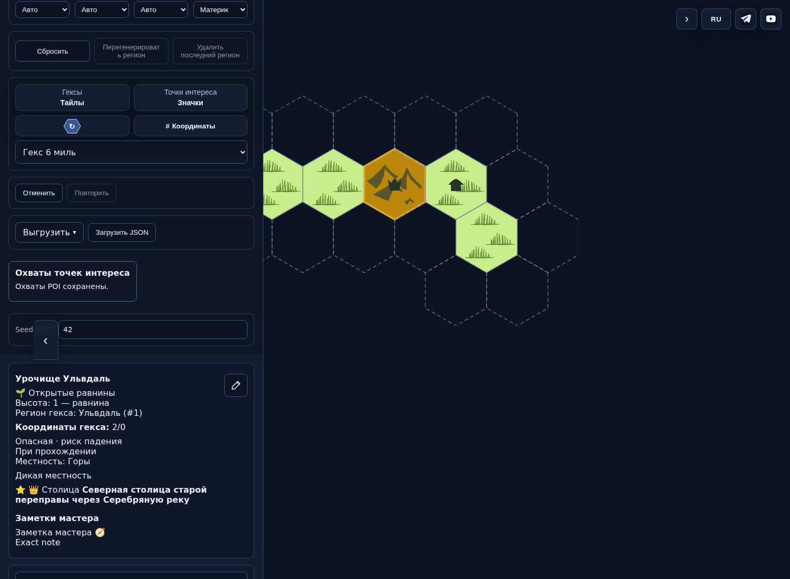
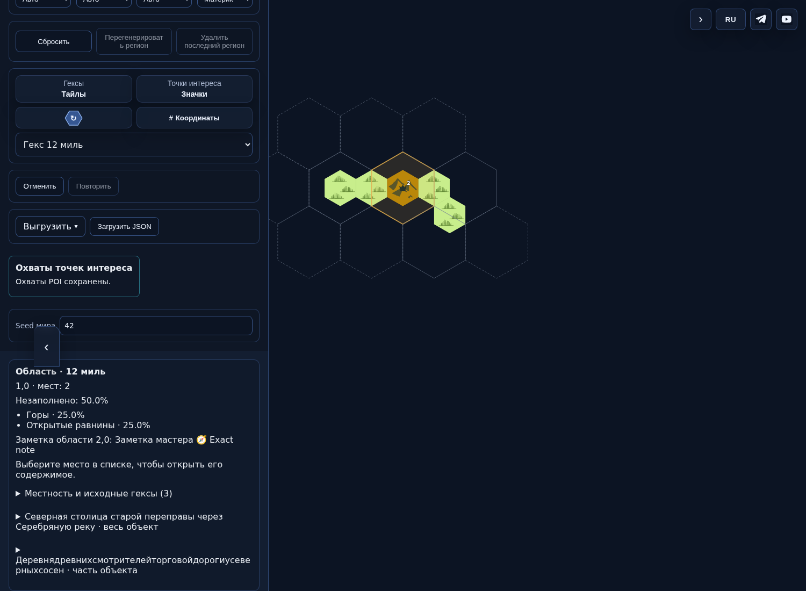
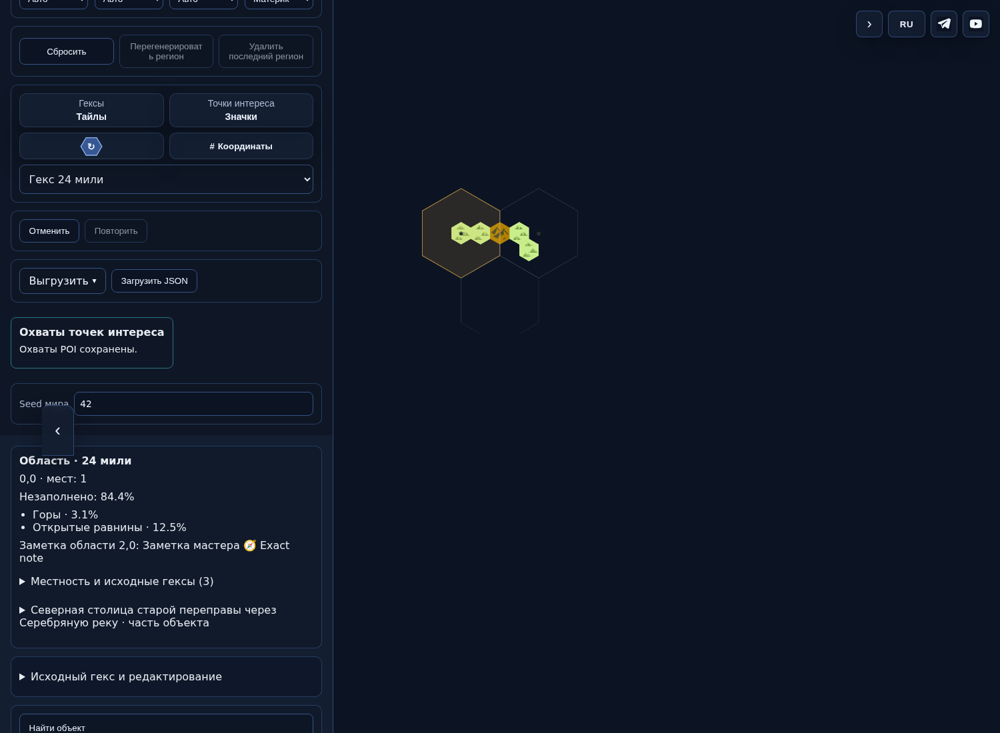

# Одна карта в четырёх масштабах — PR496

Фактические снимки проверенного SHA `9ca7dc6d5839ed897ccb784ae29d4029a5e76590`, не макеты. Одна и та же тестовая карта: пять исходных шестимильных гексов, столица и деревня. Между кадрами изменён только вид; география и RNG сохранены. Слева показан реальный интерфейс. Публикация PR496 приостановлена владельцем.

Источник: CI43077183353, artifact13883355220; SHA256 ZIP `3841be64a0395a8fce11a03a902c26447256955498627c6d41810de42290e4cb`. PNG скопированы без обработки; их Git blob hashes проверены.

## 1 миля

Локальная детализация выбранной ячейки и охват места.

## 6 миль

Базовая сетка и обычная карточка исходного гекса.

## 12 миль

Обзор выбранной области; незаполненная часть остаётся видимой.

## 24 мили

Более крупный обзор той же территории и сводка содержимого.

