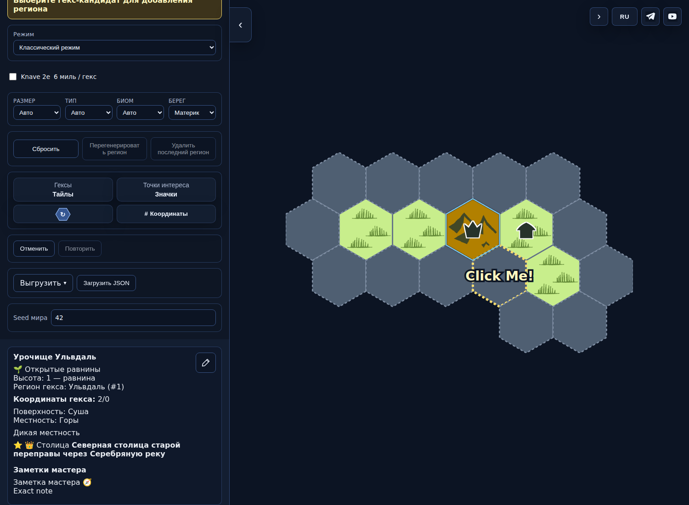
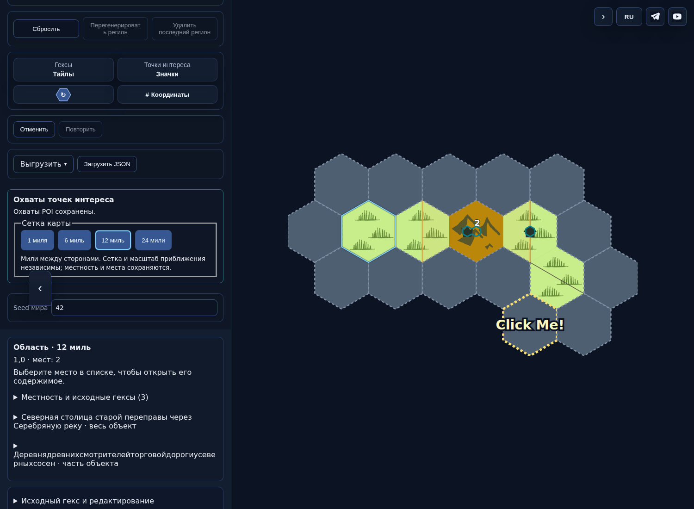
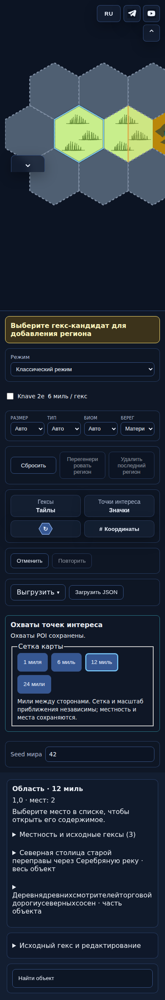
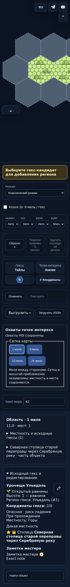

# PR496 — выпускной показ и завершение подготовки

Кандидат f677629c4c1c3a84656ad88a6e118c56da3c7eb3, tree b0f479b31cec65bfe240da06ed60743c8327a25d. Опубликованная база1962fb9a835a9c310e55c1a09415fe180f22cca9. Публикация отдельно разрешается владельцем; эта подготовка не меняетmain.

Пакет: DETAIL1 — физические охваты мест и независимое отображение1/6/12/24мили; CLASSIFY1 — проходимость и условия обнаружения. Адаптация старой карты выполняется явно через предпросмотр/Apply/Cancel. Смена сетки не перебрасывает географию и содержимое. Общая обзорная ячейка перечисляет отдельные места и исходную местность. Условный минимальный охват столицы не объявляется измеренной границей города.

## Фактическое до/после

Одинаковые старыеJSONv8байты импортированы опубликованнымmain и exact-кандидатом. Исходная карта содержит5авторских исходных ячеек,2POI, длинные названия и заметку. Проверены неизменность исходных географии/имён/заметок/RNG при адаптации, отсутствие обычной лишней строки местности, редакторская строка поверхности, опасная проходимость и обнаружение. Подробнееwalkthrough.json; вход/экспорты сохранены рядом.

Опубликованная версия:

Кандидат, область12миль и оба владельца:

Узкий экран390:

320, сетка1миля:

Основное до/после и390предъявлены владельцу в текущем чате. Показ не является запросом третьего дизайн-согласования.

## Происхождение

[CI42906586915](https://github.com/YuriyEmelyanov/Hexcrawl/actions/runs/42906586915), job130146210771, [полный артефакт13804069164](https://github.com/YuriyEmelyanov/Hexcrawl/actions/runs/42906586915/artifacts/13804069164). ZIPsha256 a051707db1396884f7bfe5f1df21019ae165826d0fb91c5c47283b4c1ff9cadc проверен после скачивания. Checkout0c58d3d — технический PRmerge commit с точно тем же treeb0f479b, чтоheadf677; это не публикация. Полные20PNG,4уровня, предпросмотр и12/24PNGэкспорт находятся в артефакте. Выбранные изображения и JSON продублированы в этой директории; ui-manifest.json содержит хэши.

Ограничения: авторский малый пример, Chromium/эмуляция ширины; не все устройства и не широкая выборка генератора. Desktop6/24из полного артефакта сняты во время существующегоCSStransition переключателя панели при смене viewport; это ограничение кадра, независимо проверенное, не установленный runtimeдефект. Владельцу предъявлены12и узкий кадр. Существующий обязательныйDETAIL1browserworkflow отдельно проверяет историю, ручной охват7ячеек, водные/дорожные контакты, владельцев общей ячейки, клавиатуру, PNGи44pxкнопки.

## Реки и точность заключения

Сохранённый ранее реальныйCIbefore(seed1702308986, Classic/locality, кандидат2,-2) воспроизводит CYCLE/RIV016 и в опубликованной базе, и в прежнем9aa. Обе ветви генерации теперь проверяют полную сеть, повторно используя действующую политику точного сохранения старых взаимодействий. На кандидате тот же вход принимает допустимый4-йрегион. Принудительно недопустимая полная сеть вызывает30regular+30tractпопыток и точный откат документа, Undo/RedoиRNG. Существующий старыйCYCLE не прикрывает новыйSCCилиLAKE_AREA. Диагностики и исходное отрицательное заключение сохранены отдельно.

Причина историческогоRIV011unknown: вход/seed72.746,-14отсутствуют. Технический disposition controlled_original_cause_unknown основан на точной общей проверке доcommit и независимых ограниченных проверках; не означает воспроизведения/исправления неизвестного исходного входа и универсальной корректности гидрологии.

Итог независимой проверки, score_assessment1.2 и test_change_summary находятся в подпапкеreviewer; итоговые обязательные проверки — checks.json. Баллы не начисляются до публикации; unknownне означаетG0.
