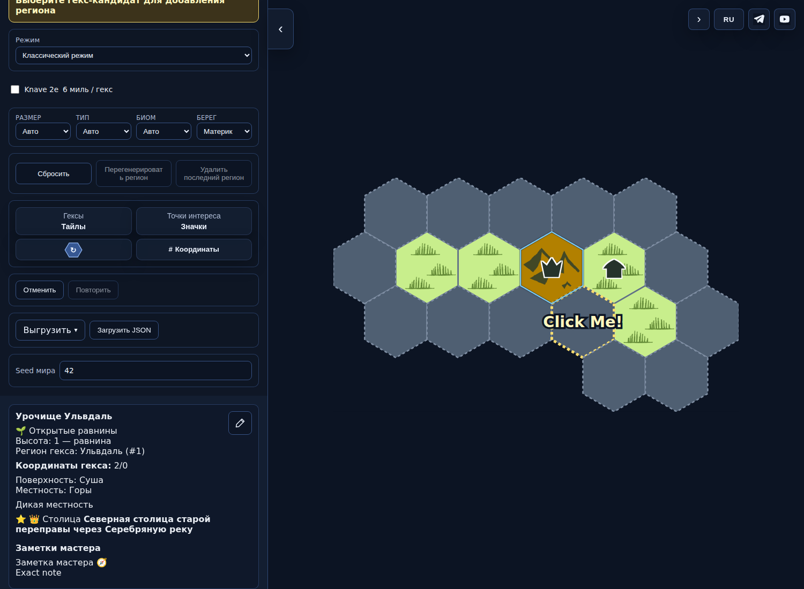
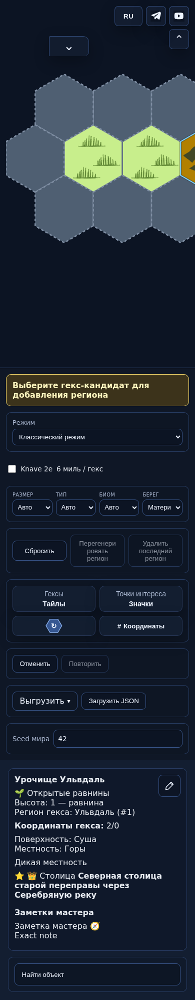
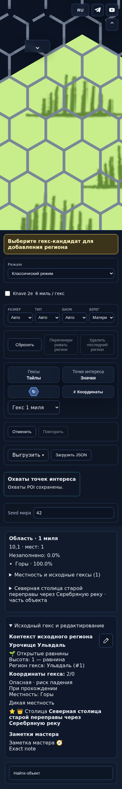
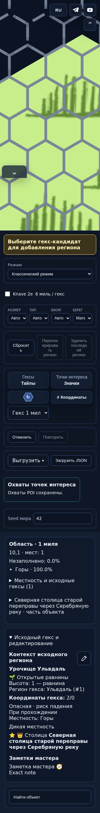
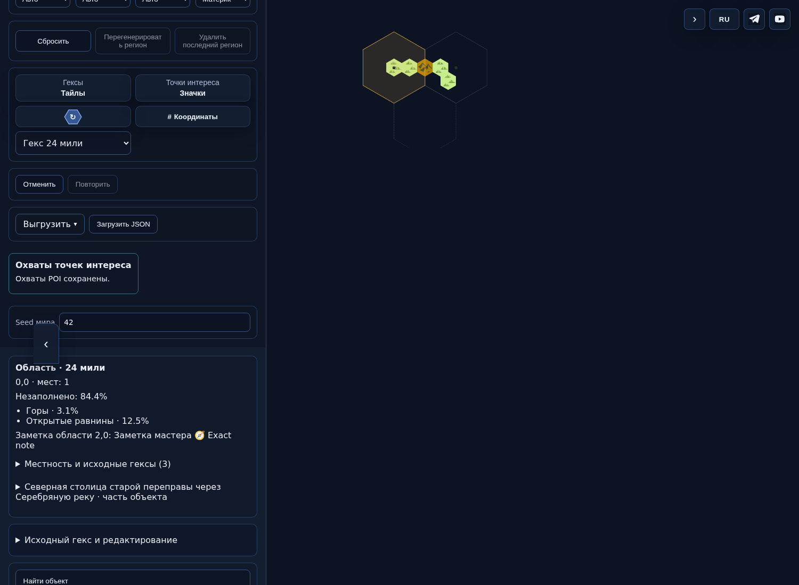
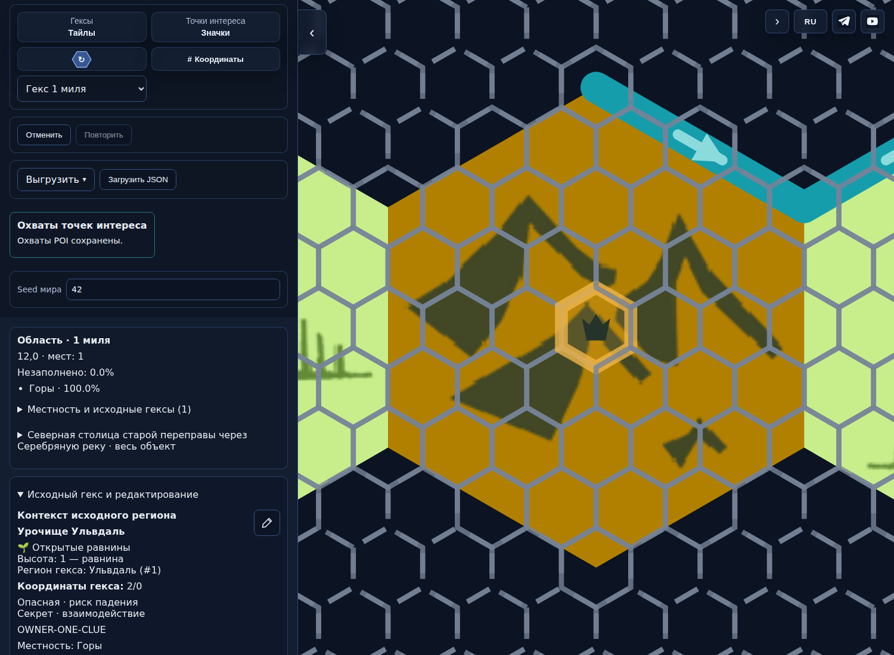
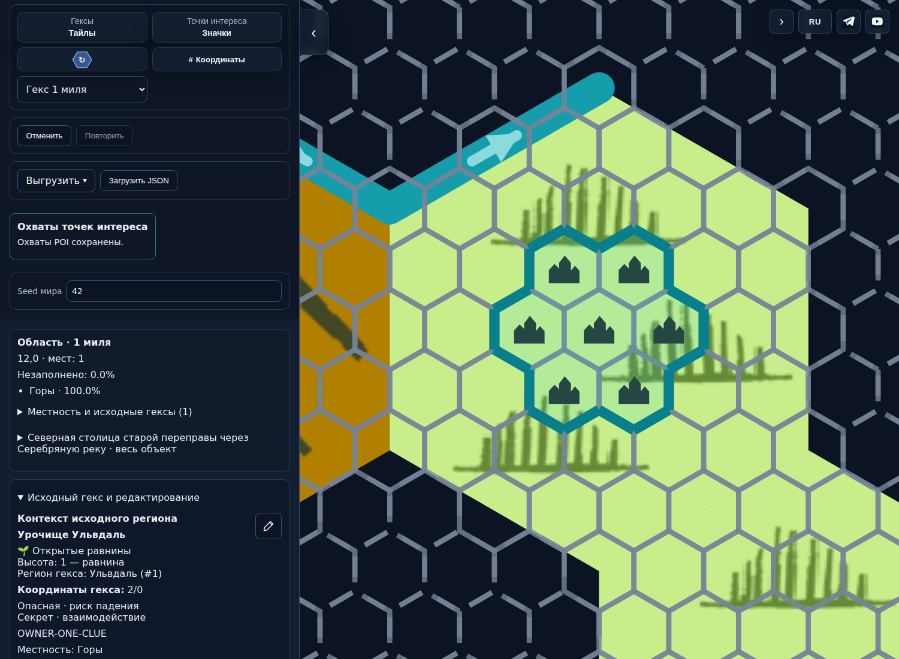

# Фактический интерфейс PR496

Head: `3aff650ca8a2c6c24989bcb97f0fefe346fabec7`; tree: `4274d71d2d38222c0cefa6f1ebd6640a40235487`. Это работа приложения, не макет. Публикация не разрешена.

Одинаковая сохранённая карта: опубликованный main и текущий кандидат. На6милях остаётся обычная карточка; на1миле — локальная; на12/24 — смешанная сводка с неизвестной площадью. Переключатель находится в блоке координат. Единая выбранная сетка включает полные крупные ячейки и кандидатов.

| Состояние | Опубликованный main | Кандидат |
|---|---|---|
| Desktop |  |  |
| Узкий экран |  |  |

Заданный измеренный диаметр столицы0,4мили: один значок, без обводки POI. Жёлтая линия — выделение выбранной ячейки.

Условная оценка города1,5мили: общая внешняя обводка; повторённые значки — ссылки на один объект, не отдельные места.

Поворот90°: четыре видимых перехода, максимальное отклонение0,435px, замкнутый цикл0px. Без поворота:0,477px/цикл1px. Это один фиксированный пример, не универсальная оценка.

Ограничения: GRID-Q01/G10 о создании региона вне6миль пока не разрешён; такие клики отказывают с предложением базового вида6миль. TABLES1/PF2 не включены; интеграционная совместимостьv12/v13 не заявлена. Полное принятие задачи и выпуск не объявлены. Размеры каталога — допущения проекта, не измерение реальных городов. На320px текст native-select может сокращаться, значение/варианты доступны.

Манифест с SHA256 и источниками: [ui-manifest.json](ui-manifest.json). Полные варианты1/6/12/24 на1500/390/320 и экспорты: GitHub Actions [run42998005924](https://github.com/YuriyEmelyanov/Hexcrawl/actions/runs/42998005924), артефакты PR496-release-presentation и DETAIL1-UI.
