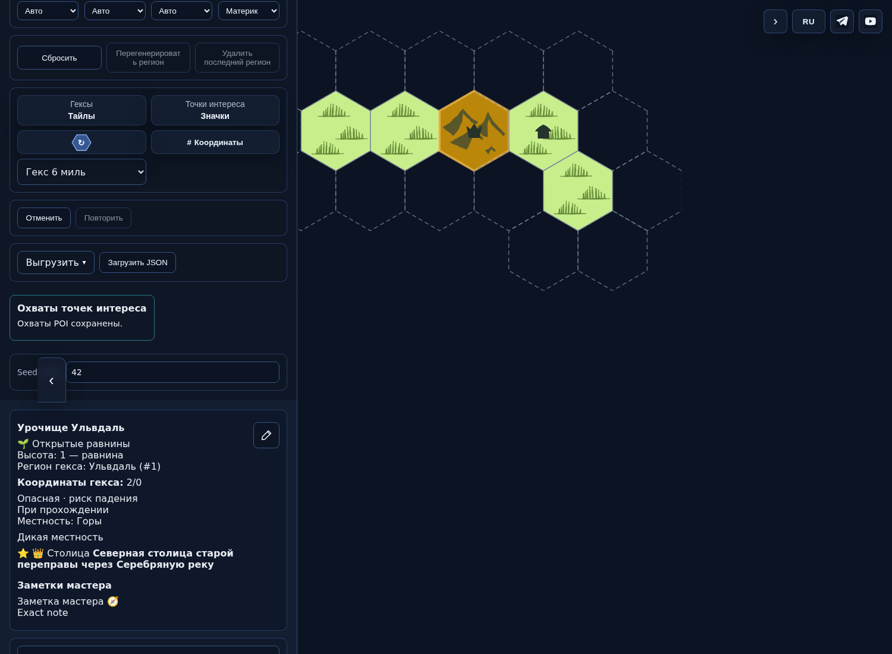
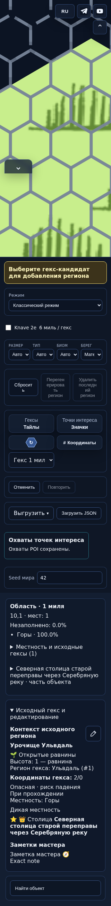

# PR496 — фактический интерфейс dd9b555

Это работающий интерфейс, не макет. Head`dd9b5554106091325a12ad2351385b30e43806c3`; проверенный merge-checkout имеет то же дерево. Снимки получены из одного авторского сохранения на опубликованном main и кандидате PR496.

| Состояние | Снимок |
|---|---|
| До, desktop |  |
| После, стандартные6миль |  |
| После,24мили/неизвестная площадь |  |
| До, узкий экран |  |
| После,1миля/390px |  |
| После,1миля/320px |  |

Сетка/кандидаты одного физического размера, полный крупный гекс с незаполненным пространством; обычная карточка6 и локальная/обзорная информация. На1миле крупные POI имеют общий контур, малые остаются маркерами. Размеры каталога — явно проектные оценки.

Ограничения: фиксированная небольшая карта и эмуляция шириныChromium. GRID-Q01 (пустая генерация вне6миль) и интеграция ещё не выпущенныхv12/v13 остаются незавершёнными. Снимки и passedwalkthrough не означают независимой приёмки всего пакета или разрешения публикации. Полные sourceartifact/sha256 и выбранные PNG blobs: ../ui-manifest.json.
