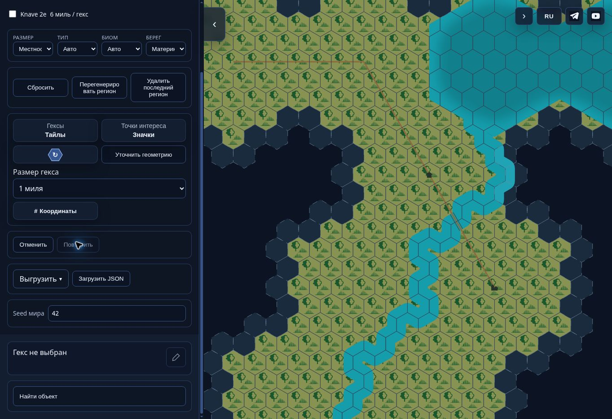

# PR503 опубликован

Версия `adc96d8ed99347d0df722bbbd44f11d069ac7df4`; merge `b7d0a5637ac5980efc8b91ed425dd7bab5577c8f`. Дерево merge совпало с принятым: `00006887cb0bc94481ef75960ca137ec2dd0ed5d`.

[GitHub Pages — success](https://github.com/YuriyEmelyanov/Hexcrawl/actions/runs/43748705026). [Сайт](https://app.hexcrawl.ru/).

На живом сайте создан новый регион seed42: 6→1миля, предпросмотр и применение уточнения (1река,2дороги), Undo/Redo. Фактический снимок: .

Исходную шестирегионную карту в облачном браузере открыть не удалось: file chooser завис и вкладка исчезла. Не объявляем этот live-сценарий пройденным; он прошёл до выпуска в принятом CI. Ограничение читаемости мелких POI сохранено.
