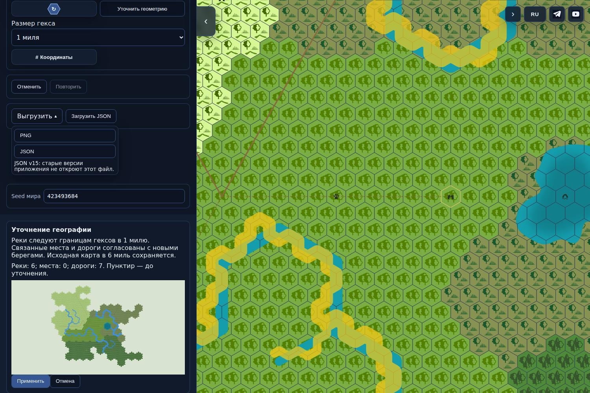
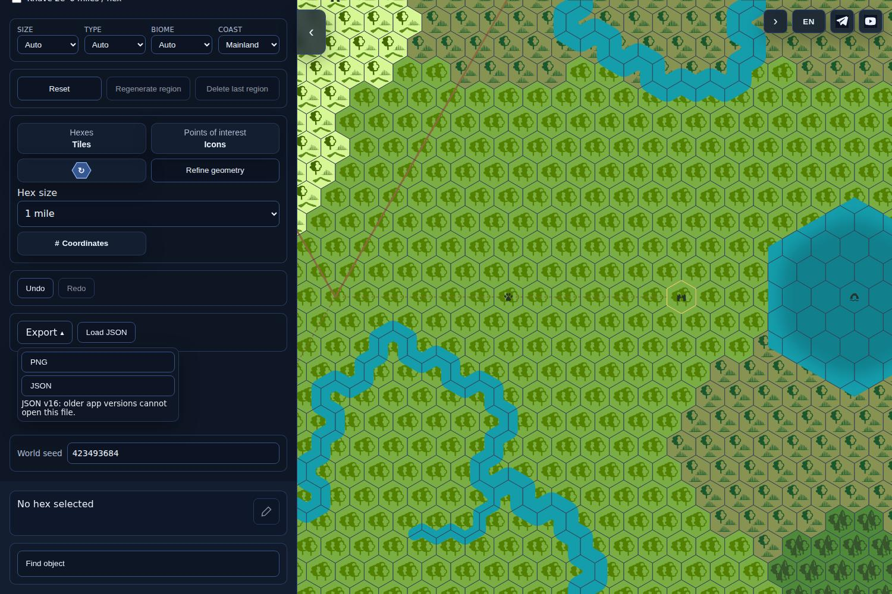

# PR503 — реальный сквозной результат

Версия: `afebeb085e0bc0059e317ff6a64d02a9f8e46393`, дерево `b6c451cea311fdef56bd8c784238898ffcf191ed`. Код находится непосредственно в PR503. Основной сайт ещё не опубликован.

В виде 1 миля команда «Уточнить геометрию» показывает предложения поверх основной карты и отдельное сравнение. Apply принимает один общий документ; Cancel/Escape сохраняет принятую карту. Карточки, сохранение16, Undo/Redo и PNG используют принятые русла, дороги, места и переправы. На стыках пороги следуют фактической оси, водопады остаются вертикальными при повороте.

## Проверки

[CI точной версии](https://github.com/YuriyEmelyanov/Hexcrawl/actions/runs/43734521536): Node424/424, TypeScript/build, browser и отдельный RNG-browser прошли. Артефакт ONE-MILE1-UI (`14169778337`) содержит исходный manifest, изображения1500/390/320, RU/EN, ошибки и занятый импорт, PNG Tiles/Emoji/Color/rotation и экспорт при открытом предпросмотре.

Проверены53 исходных участка и7 переправ, включая отдельный допустимый F2-брод. Ordinary source edit не открывает дополнительное согласование геометрии. Внедрённая ошибка подготовки сохраняет карту и Redo; полный ID объекта отображается в RU/EN.

[Проверки и сохранённые отрицательные результаты](checks.json), [независимая приёмка G201–G210](package-review.json), [score1.2 без начисления](score-assessment1.2.json).

Проверки относятся к конечному корпусу и не доказывают отсутствие любых дефектов. Игровая широта и полные критерии score не оценены. Физическая калибровка и новый каталог размеров городов не входят в этот пакет. Неподтверждённый риск нового внешнего подхода к перемещённому POI сохранён в review, не скрыт как выполненный сценарий.

Следующий шаг — проверка конкретного пакета владельцем; публикация требует отдельного разрешения. Новое интервью для продолжения уже выполненной реализации не требуется.
