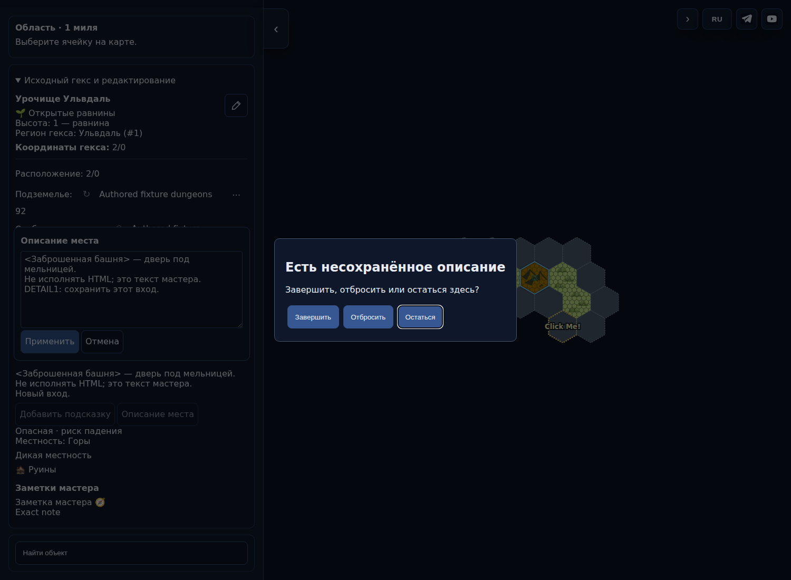
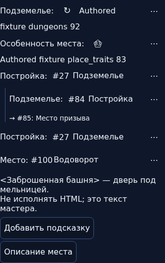
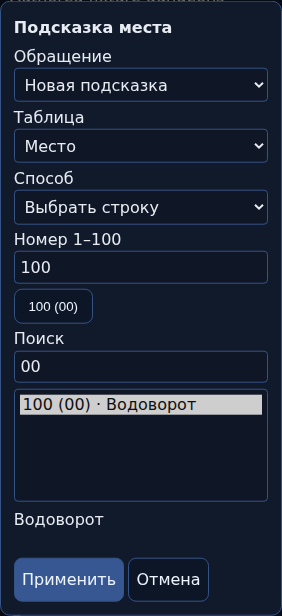

# TABLES1-REV-01 — actual UI 9cf202e

Тестовая импортированная карта, не опубликованная версия. При попытке уйти через DETAIL1 Enter/Space/клик изменённый текст сохраняется в черновике до явного решения. В исходном6d5 обработчик менял ревизию и терял локальный draft; воспроизводимый before/after handler evidence рядом.

CI42938857674 прошёл расширенный UI lifecycle: Stay/Discard/Finish, данные владельца, RNG, Undo/Redo,44px targets. Полная независимая приёмка и оценка1.2 ещё впереди; никаких баллов или разрешения публикации этим не присваивается. [Манифест](../ui-manifest.json).
