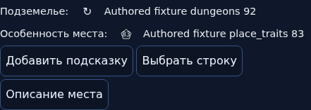
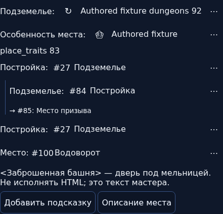
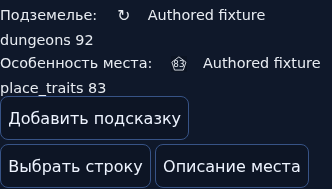
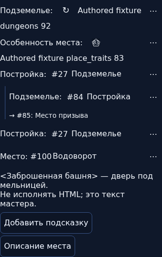
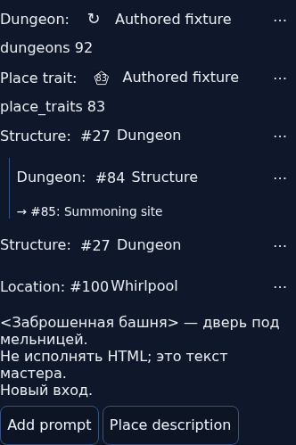
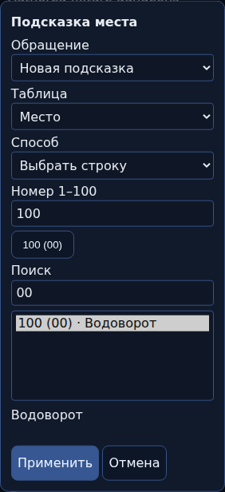
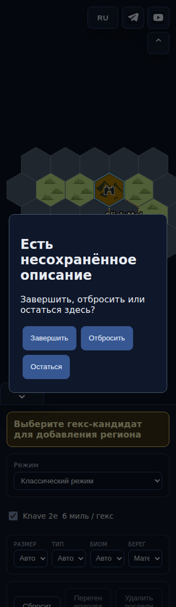

# TABLES1 — фактический интерфейс

SHA `6d5c9f4f6ec6b3a80355157e1d5e481d4d55a868`, CI [42932730122](https://github.com/YuriyEmelyanov/Hexcrawl/actions/runs/42932730122). Это тестовая импортированная карта; строки «Authored fixture» — авторские данные fixture, а не цитаты книги. Показаны состояния до и после добавления подсказок в новой версии приложения, а не сравнение с опубликованным main.

## До подготовки места, desktop

## После подготовки, desktop

Добавлены две независимые одинаковые подсказки, связанное уточнение с явной следующей строкой, результат100(00) и текст мастера.

## Узкий экран и английский интерфейс

## Выбор строки и уход из изменённого описания,320

Описания мастера не переводятся автоматически. Apply/Finish во время IME не сохраняет текст. Полная независимая приёмка ещё впереди; finite fixture не доказывает все игры, устройства и сочетания переноса/воды/DETAIL1. Проверки, SHA/tree bridge и хеши PNG — в [манифесте](../ui-manifest.json). Публикации не было.
