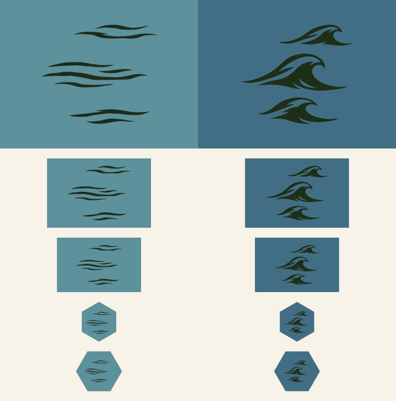

# HX-BL-060 · Интервью по единому виду карты

[Черновик D2](../../../specs/HX-BL-060-unified-biome-map-D2.md) · [Раунд 001](round-001.json) · [Реестр решений](decisions.json)

Слева озёрная рябь, справа морские волны. Лист взят из архива исходников воды.

## MAP-Q01 · Гравюры озера и моря

Принятый объём включает оба рисунка. В архиве рябь и волны помечены как кандидаты, а отдельного подтверждения этих файлов в проверенных материалах не найдено.

- **A. Взять озёрную рябь и морские волны с приложенного листа.** Оба файла входят в общий каталог и проверяются на карте и в PNG.
- **B. Заменить один или оба рисунка.** Выбор указывается по каждому рисунку. До замены соответствующий файл остаётся кандидатом.

**Рекомендация A.** Гравюры уже подготовлены в двух согласованных цветах, различимы по характеру волн и имеют проверяемые исходники.

Допустим свой вариант свободным текстом.

## MAP-Q02 · Контур озёр в едином виде

Прежний режим «Цвет» рисует округлые заливы, острова и плавные устья. В «Тайлах» вода заполняет озёрные гексы. Единый вид должен выбрать одно представление.

- **A. Сохранить естественный берег и устья из режима «Цвет».** Озеро сохраняет плавные формы и соединения с реками. Гравюра целиком лежит в воде своего гекса, когда позволяет место. Случай нехватки места задаёт MAP-Q03.
- **B. Показывать озеро целыми гексами, как в «Тайлах».** Граница воды идёт по рёбрам, как на широком макете D2. Плавные заливы и устья исчезают. Состав водных гексов и пути рек те же.

**Рекомендация A.** Сохраняет ранее согласованное естественное очертание и читаемость соединения реки с озером.

Допустим свой вариант свободным текстом.

## MAP-Q03 · Гравюра у воды, когда ей тесно

На 1 миле река может занимать до половины ширины гекса. После сдвига не всегда гарантировано место для целой гравюры высотой 55% с отступом 0.04R. В обоих вариантах ширина реки, берег и проход дороги сохраняются.

- **A. Сдвинуть целую гравюру, при нехватке места оставить только цвет гекса.** Размер 55% сохраняется для каждого показанного рисунка. На тесных гексах цвет и вода читаются без гравюры.
- **B. Сдвинуть целую гравюру, при нехватке места уменьшить её.** Рисунок остаётся там, где уменьшенная версия читаема. Для исключений потребуется нижний предел и проверка экрана и PNG. При отсутствии читаемого размера остаётся цвет.

**Рекомендация A.** Сохраняет фиксированный размер и узнаваемость силуэтов. Исключение ограничено гексами, где проверка реального размещения докажет конфликт.

Допустим свой вариант свободным текстом.

## MAP-Q04 · Несколько точек интереса в одном гексе

Один знак получает круг радиусом 0.425R. Несколько существующих значков могут столкнуться при сохранении положения возле воды или дороги. В обоих вариантах все точки доступны, существующие позиции, отпечатки и контуры крупных точек сохраняются.

- **A. Один общий круг с несколькими значками в месте пересечения.** Все значки видны на одном фоне биома их гекса. Отдельные круги остаются там, где умещаются. В PNG видны все соответствующие знаки.
- **B. Отдельный круг для каждой точки, при столкновении уменьшать круги и значки.** Индивидуальное оформление сохраняется, но значки становятся мельче. Нужны проверка читаемости и минимальный размер.

**Рекомендация A.** Поддерживает различимость отдельных знаков при плотном размещении и фиксированный размер круга вне исключения.

Допустим свой вариант свободным текстом.

## MAP-Q05 · Порядок показа и выпуска

Ранний выпуск одного масштаба даст видимый результат, но временно нарушит единое оформление при переключении масштаба. Постоянный объём и требования сохраняются в обоих вариантах.

Только если уточнённый прогноз подтверждает, что оба режима нельзя довести до выпуска примерно за сутки. До этого действует цель совместного выпуска и первый рабочий пример в 6 миль.

- **A. Показать рабочий пример в 6 миль, опубликовать вместе 6 и 1 милю.** Изменение приходит сразу на оба масштаба. Рабочий пример можно увидеть раньше согласования выпуска.
- **B. Выпустить 6 миль первым, 1 милю вторым.** Первый пакет даёт новый вид, сохранения и PNG в 6 миль. На 1 миле временно старый вид, пока второй пакет не пройдёт приёмку. Каждый пакет согласуется отдельно.

**Рекомендация A.** Временно разные оформления расходятся с целью задачи. Вариант B имеет смысл, если пересчитанный срок оправдает компромисс и владелец явно его разрешит.

Допустим свой вариант свободным текстом.

