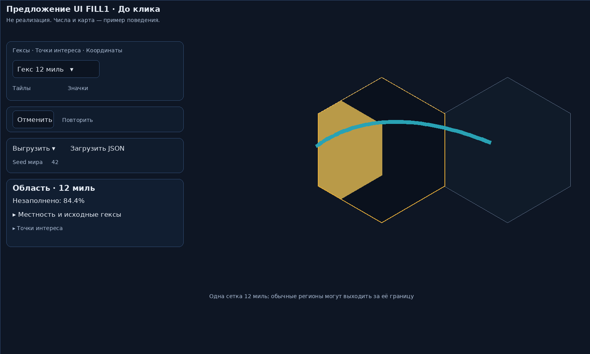
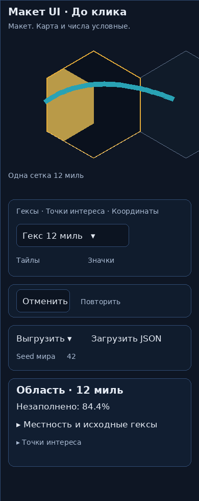
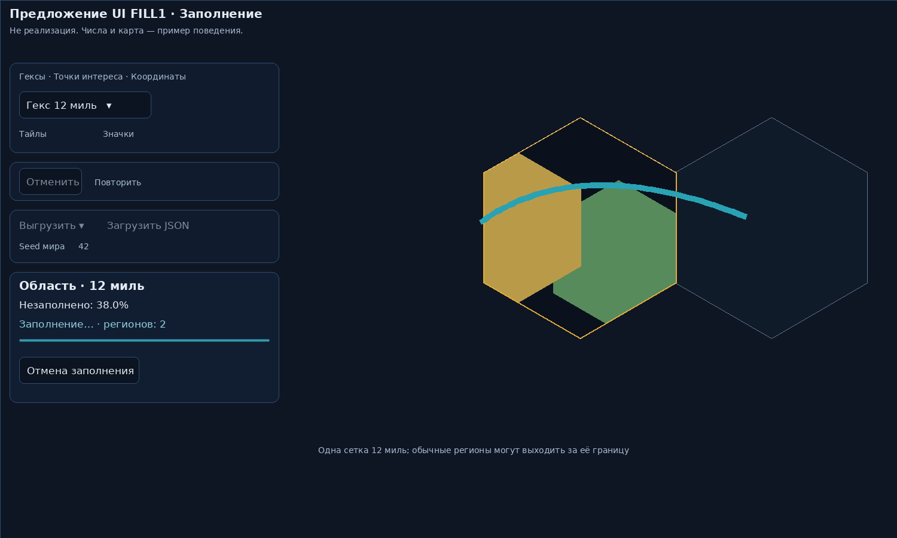
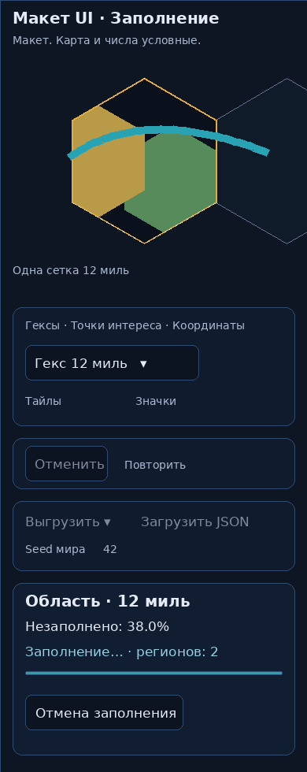
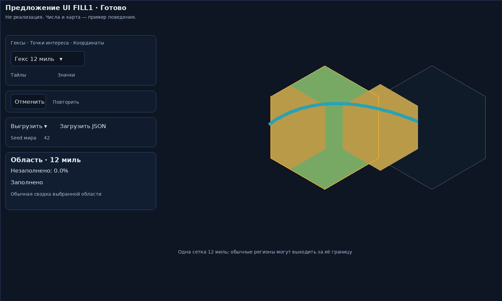
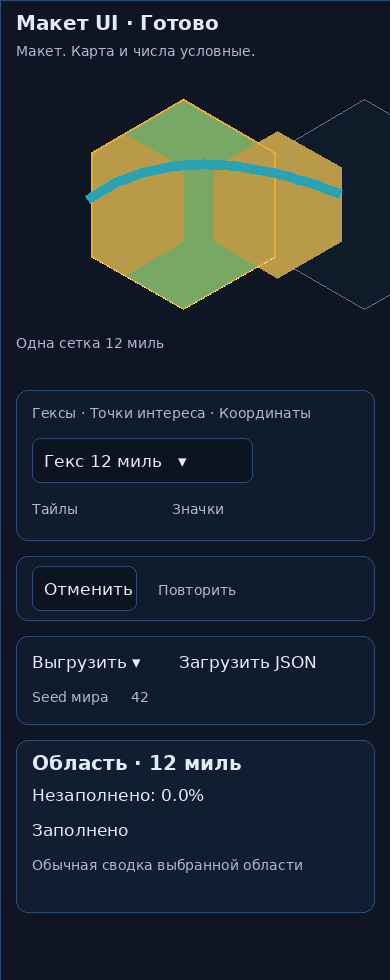
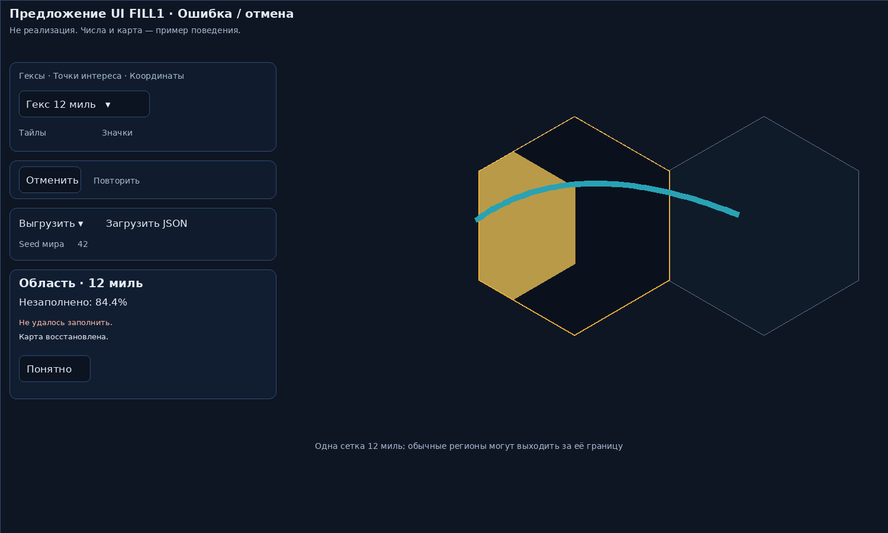
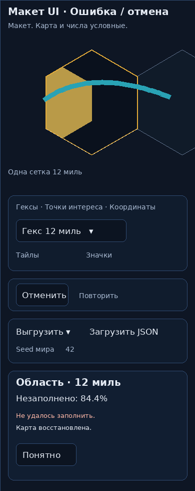

# Предложение UI FILL1 — не реализация

Основа: текущий PR496 `3aff650`, его цвета, блок координат, карточка области и порядок desktop/narrow. Это авторский макет изменения процесса заполнения. География, проценты и количество регионов условные, не измерения и не работа генератора. Статус и кнопка отмены остаются в существующей карточке; дополнительных подтверждений каждого региона нет.

| Состояние | Desktop | Узкий экран |
|---|---|---|
| До клика |  |  |
| Заполнение |  |  |
| Полностью заполнено |  |  |
| Ошибка или отмена |  |  |

[Интерактивный просмотр](proposal.html) переключает иллюстративные состояния, а не запускает генерацию. Карта заполняется по клику на доступную пустую часть выбранного12/24-гекса. При успехе одинUndo возвращает всю партию; при Cancel/Escape/ошибке исходный документ восстанавливается. «Удалить последний регион» после успеха сохраняет прежнюю предметную историю.

Показ: текущий чат владельца, desktop и narrow. Просмотр/ответ не являются третьим блокирующим согласованием. До публикации программист покажет реальный интерфейс на новомSHA; проверяющий отдельно его проверит.

PNG воспроизводятся: `node render.mjs && python render_png.py`. SVG/HTML — авторский источник. Локальный Chromium не запускался из-за socketEPERM, ImageMagick не нашёл rsvg-convert; PNG отрисованы из этих SVG ограниченным собственным Pillow-рендерером, без заявления browser QA. Оценка механики генерации/полного покрытия — отдельное evidence в спецификации.
