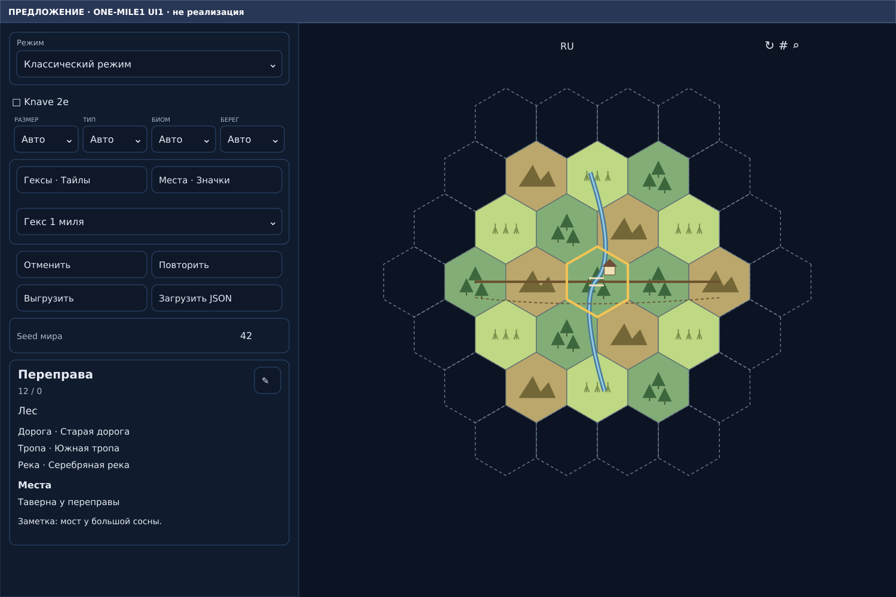
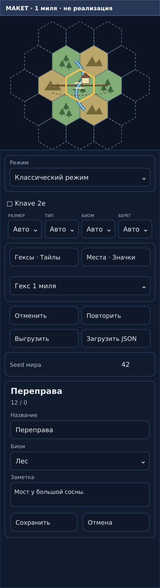
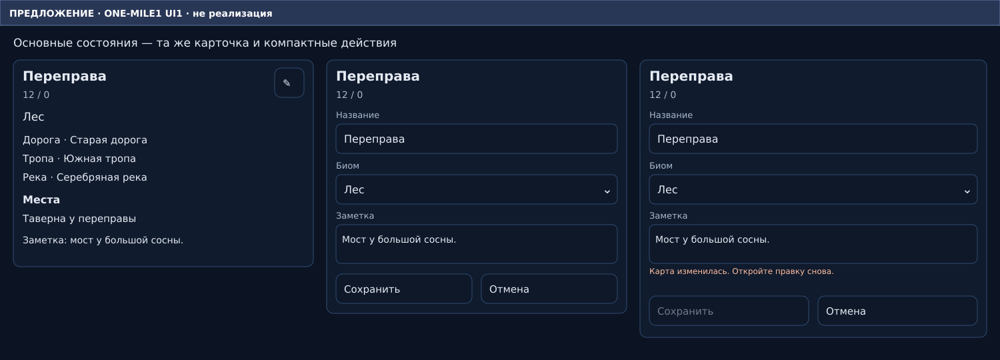

# ONE-MILE1 UI1 — предложение интерфейса

Это **макет, не готовая реализация**. Основа — существующие6-мильная карточка и панель HexCrawl. Условный пример показывает отдельный рисунок в каждой одномильной клетке, один ряд кандидатов, локальные сведения и редактор. Дорога, тропа, река и таверна здесь нарисованы для объяснения; они не являются runtime evidence.

На desktop остаётся привычная левая панель, на узком экране — карта сверху и панель ниже. Поля редактора относятся к выбранному1-мильному гексу: имя текущего языка, биом, заметка. Служебного статуса об охватах и карточки исходного6-гекса нет.

## Desktop — чтение

## Узкий экран — редактирование

## Чтение / правка / устаревшая ревизия

Дизайн показывается без третьего блокирующего согласования: команда продолжает утверждённую задачу по стандартным ролям; владелец может скорректировать его. Публикация требует отдельного разрешения.
