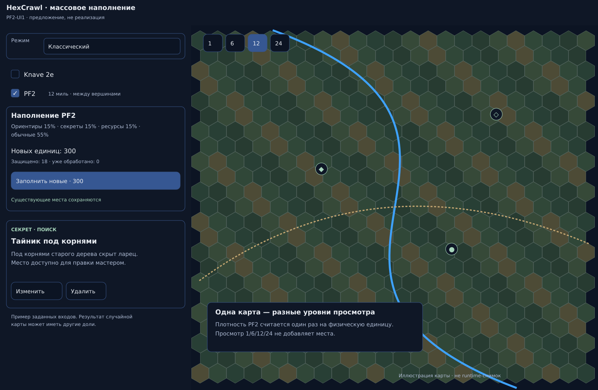
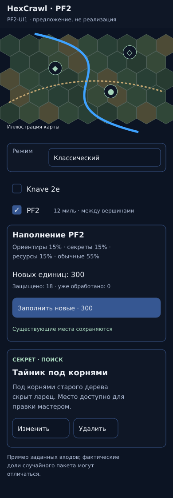

# PF2-UI1 — предложение интерфейса

Это макет, не реализация. Основан на принятом9cf App/styles; карта и числа иллюстративные. Desktop и узкий390 предъявлены владельцу в текущем чате11.11;320 и состояния доступны по ссылкам. Просмотр/ответ не являются блокирующим согласованием.

[320px](preview-320.png) · [Состояния](preview-states.png)

SVG-оригиналы лежат рядом. Генератор:build_previews.py; рендер:Inkscape CLI. Источник поведения:agent-work/specs/HX-BL-054-PF2-BATCH1.md. Фактический UI на точномSHA обязан показать программист; эти макеты не являются evidence готовности продукта.
