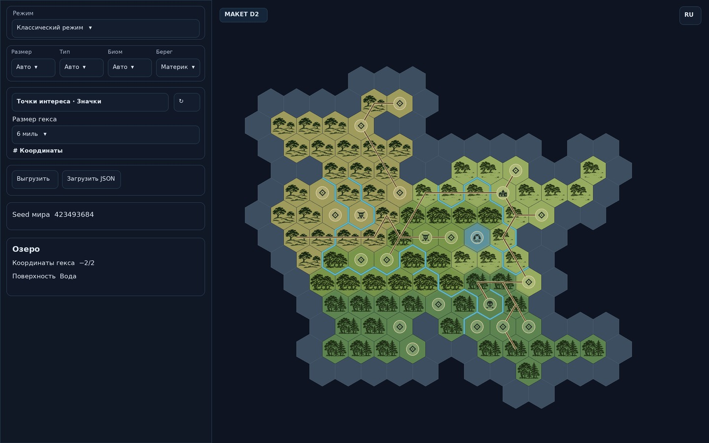
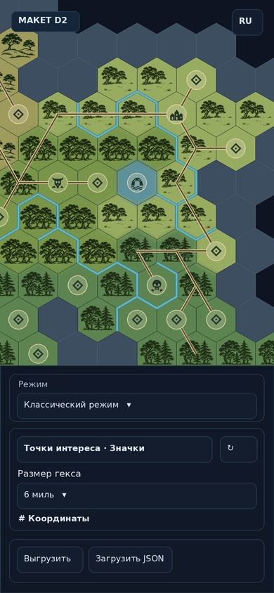

# HX-BL-060 · Предлагаемый вид карты D2

Одна и та же карта Classic с seed 423493684. Макет построен по геометрии сохранения PR505 в представлении 6 миль и по текущей компоновке панели. Новое оформление предложено для обсуждения, функция ещё на стадии спецификации. Координаты дорог и воды взяты из сохранения. Вид значков и стыков в макете схематичный. Озёрный PNG пока кандидат, а на этом гексе виден круг водной точки интереса. Базовое состояние видно в артефакте browser-прогона [PR505](https://github.com/YuriyEmelyanov/Hexcrawl/actions/runs/44119549919).

## Широкий экран, 1440 px

## Узкий экран, 390 px

В панели остались выбор размера гекса, координаты, выгрузка и отдельная настройка значков точек интереса. Управление видом гексов убрано из предлагаемой компоновки. В макете показаны только блоки панели, нужные для сравнения.
