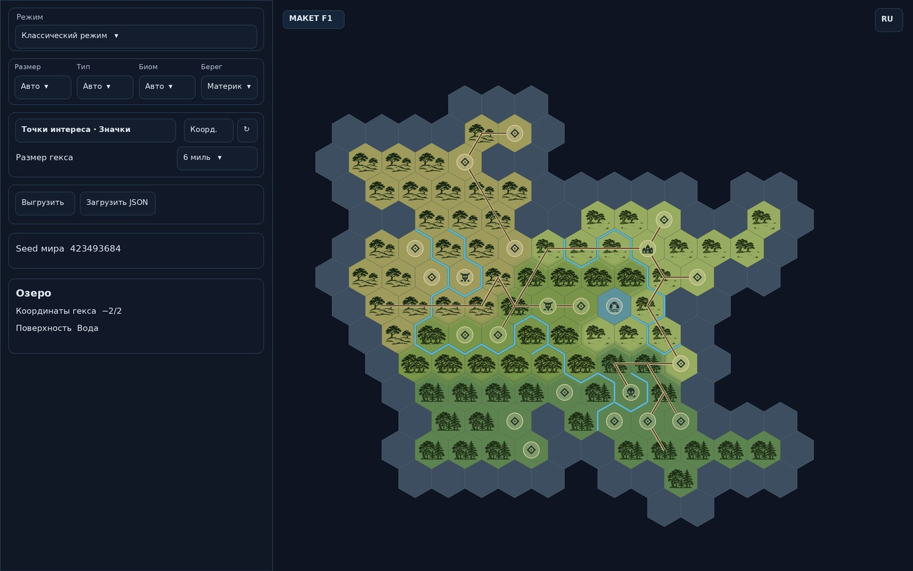
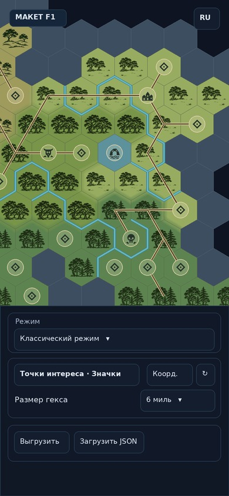

# HX-BL-060 · Предложение F1

Одна карта Classic с seed 423493684. Предлагаемый вид построен по сохранению PR505. Гравюры высотой 50% центрированы. Граница ослаблена, фон мягко переходит между биомами. Кнопка вида гексов убрана из предлагаемого блока, остальные элементы сгруппированы. Возле центра озёрного гекса виден круг существующей точки интереса.

Статический макет использует сохранённые координаты карты и упрощённый вид дорог и значков. На [странице сравнения D2](../HX-BL-060-D2/README.md) доступно предыдущее предложение. Для фактического сравнения разработка приложит опубликованный вид и реализованный вид на одной камере и точном SHA. [Метаданные](capture.json) · [Спецификация F1](../../specs/HX-BL-060-unified-biome-map-F1.md).

## Широкий экран

## Узкий экран

