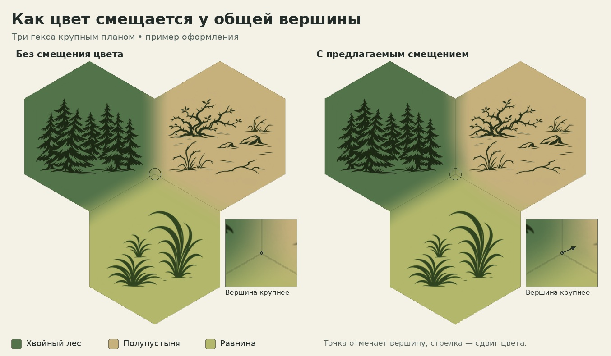
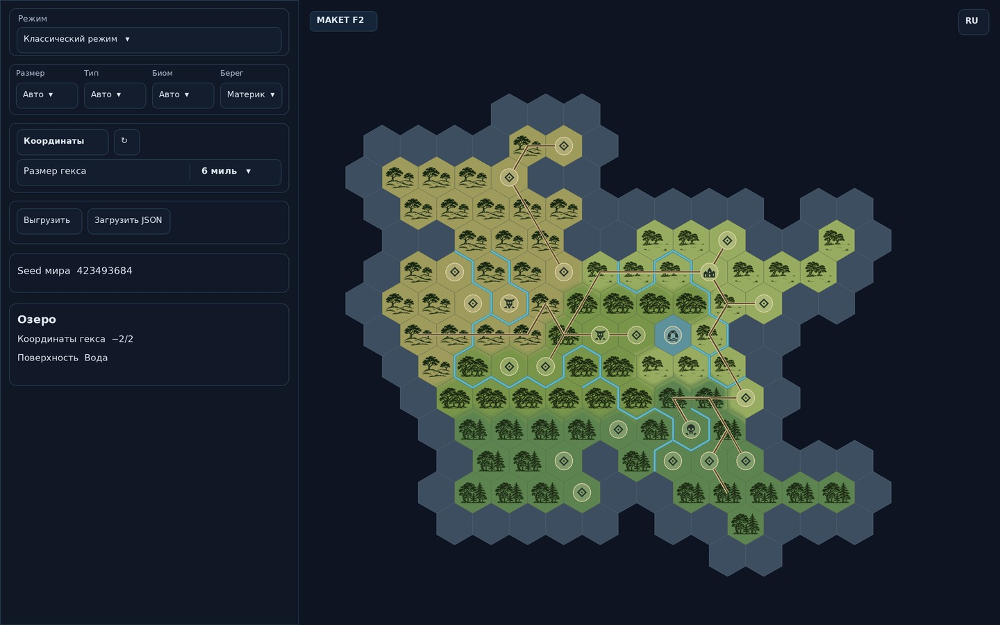
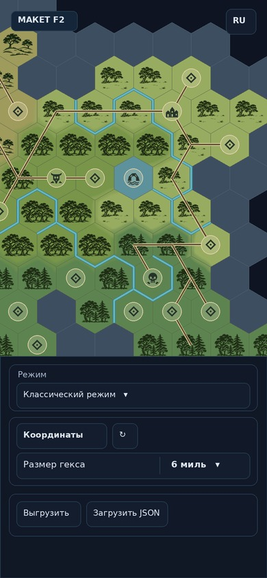

# HX-BL-060 · Предложение F2

В блоке отображения остались кнопка «Координаты» и поворот. В строке «Размер гекса» подпись стоит рядом с выбранным значением. Вид точек интереса одинаков на карте и в PNG. На панелях — сохранённая карта Classic PR505 в 6 милях. Пути и их значки показаны схематично.

## Три соседних гекса крупно

Слева цветовой переход сходится на геометрической вершине. Справа середина смешения немного смещена, а сетка остаётся на прежнем месте. Стрелка и точка служат пояснением. Это увеличенный образец для проверки предлагаемого цвета, отдельно от сохранённой карты.

## Широкий экран

## Узкий экран

[Метаданные](capture.json) · [Спецификация F2](../../specs/HX-BL-060-unified-biome-map-F2.md)
