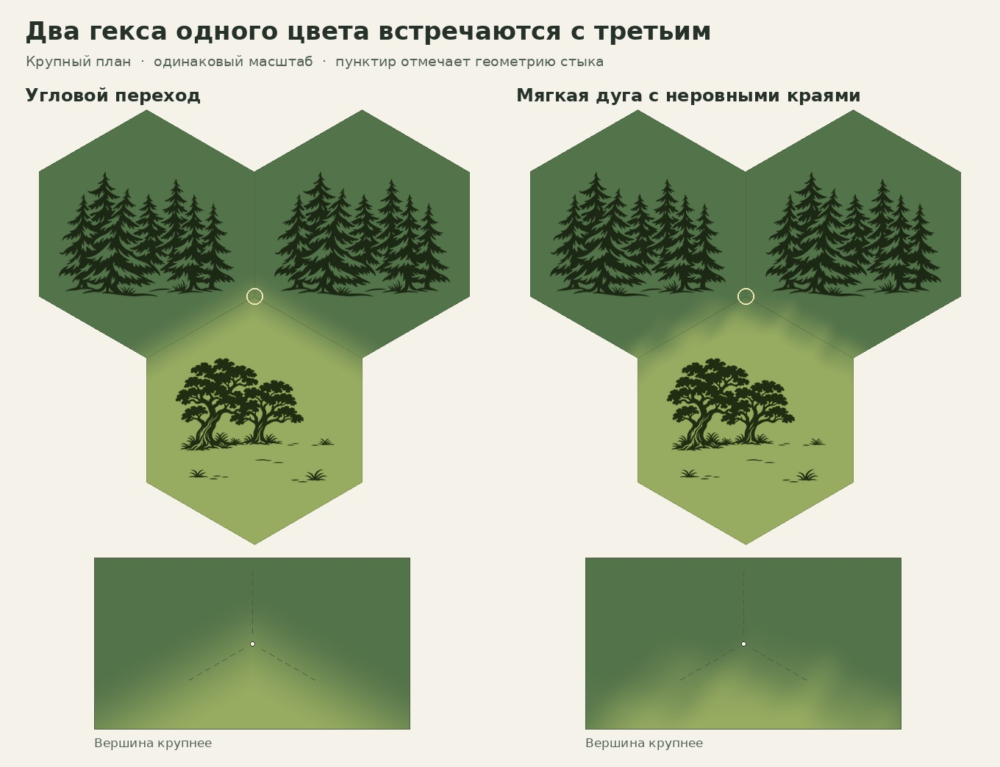

# HX-BL-060 · Переход фона F3

Два гекса хвойного леса с одинаковой заливкой встречаются с лиственным редколесьем. Слева сравнение с угловым переходом. Справа — предложенная мягкая дуга с неровной кромкой. На нижнем увеличении пунктир и точка отмечают геометрическую вершину, общую для обоих вариантов.

Использованы текущие гравюры и цвета. Параметры скругления и мелких неровностей служат геометрическим примером. Следующая проверка — тот же переход на работающей карте и в PNG на двух масштабах.

[Спецификация F3](../../specs/HX-BL-060-unified-biome-map-F3.md) · [Макеты панели](../HX-BL-060-F2/README.md)
