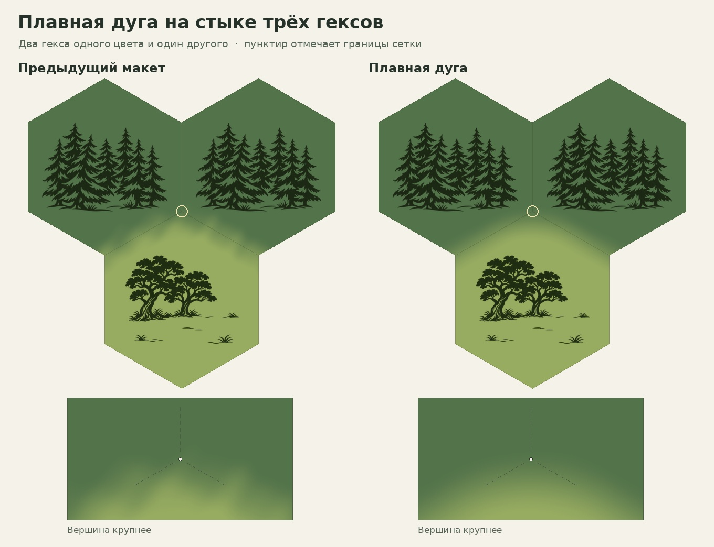

# HX-BL-060 · Плавная дуга F4

На одном стыке рядом показаны прежний F3 и предложенный F4. Справа середина размытия идёт одной плавной дугой. У внешних кромок остаётся едва заметное изменение ширины. Внизу тот же стык показан крупнее. Пунктир отмечает границы гексов.

[Спецификация F4](../../specs/HX-BL-060-unified-biome-map-F4.md) · [Макеты панели](../HX-BL-060-F2/README.md)
